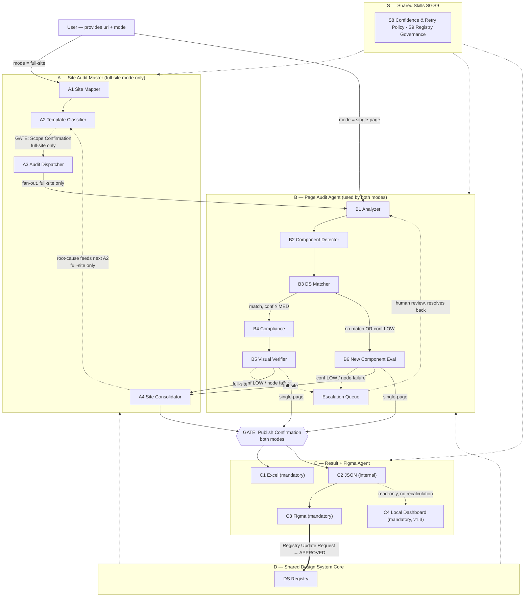

# AI Design System Audit Agent — Architecture v1.3

**Base:** `Ken_Research_AI_Design_System_Audit_Final_Architecture.pdf` (v1.0). **v1.1:** graph-engineering layer, confidence routing, feedback loops, responsibility refinement, entry contract (all additive). **v1.2:** failure/retry handling, concurrency-safe state, execution tracing, confidence calibration, real-page validation fixes, and the output/storage model. **v1.3 (this doc):** adds the Local Audit Dashboard as a third mandatory output (§6) — a new C4 node, explicitly directed, not a redesign of C1–C3.

**No node has ever been renamed, removed, or restructured across any of these passes.** Every addition through v1.2 was a new edge, a new state field, a new *shared skill* (S8, S9 — appended after v1.0's S0–S7), or a clarification of an existing node's responsibility — `A1–A4 / B1–B6 / C1–C3 / D1–D6` stayed exactly as v1.0 specified them. **v1.3 adds one genuinely new node, C4 Local Audit Dashboard**, alongside — not in place of — C1–C3, which remain untouched. C4 performs no independent calculation: it reads the same C2 JSON/Audit Data every other C-layer output reads, per §6 below.

Status: architecture-only. No implementation code exists yet — that's a separate, later implementation plan (repo scaffolding for the actual A1–A4/B1–B6/C1–C3 code is not part of this document).

See also: [`RESEARCH-REFERENCES.md`](RESEARCH-REFERENCES.md) (54 sources this document's design choices are grounded in — cited inline as `#N`) and [`VALIDATION-NOTES.md`](VALIDATION-NOTES.md) (the real-page dry-run walkthrough that produced §2.7 and several §5 clarifications).

---

## 0. Entry Contract

Two inputs required at entry, every run, both modes:

| Input | Required | Notes |
|---|---|---|
| `url` | yes | site root for full-site, or the exact page URL for single-page |
| `mode` | yes, no default | `full-site` \| `single-page` — explicit enum, set by the caller |

**Hard routing rule: `mode` is the sole routing source of truth.** The system never infers or changes mode from `url`'s shape — pasting the homepage URL under `mode = single-page` audits exactly that one URL through B and nothing else; it does not trigger a crawl.

| `mode` | What runs |
|---|---|
| `full-site` | A1 → A2 → *(Scope Gate)* → A3 → parallel B → A4 → *(Publish Gate)* → C. Matches v1.0 §8. |
| `single-page` | B1 directly on `url` (matches v1.0 §9/§10) → *(Publish Gate)* → C. **A1–A4 are never invoked**, regardless of `url`. |

Validation: reject the request outright if `mode` is missing or `url` doesn't resolve — never fall back to guessing mode from URL structure.

**URL canonicalization (added — validated against a real page, see `VALIDATION-NOTES.md` §1):** before `url` is used to derive `page_id` (§2.5 rule 1) or the run-level key (§2.5 rule 6), it is canonicalized: prefer the page's own declared `<link rel="canonical">` / `og:url` when present; fall back to conservative generic normalization (protocol/case/trailing-slash/known tracking params only) when absent. Never strip a query parameter that could change rendered content — a confirmed real site had the same page linked from two different URL paths, and the canonical tag was the reliable signal, not string guessing.

---

## 1. Unchanged base

| Layer | Nodes | Role |
|---|---|---|
| A — Site Audit Master | A1 Site Mapper → A2 Template Classifier → A3 Audit Dispatcher → A4 Site Consolidator | full-site orchestration |
| B — Page Audit Agent (parallel instances) | B1 Page Analyzer → B2 Component Detector → B3 DS Matcher → (B4 Compliance Auditor → B5 Visual Verifier) \| B6 New Component Evaluator | single-URL audit |
| C — Result + Figma Agent | C1 Excel Reporter, C2 JSON/Audit Data, C3 Figma Publisher, **C4 Local Audit Dashboard** (v1.3, §6) | downstream publishing only |
| D — Shared Design System Core | D1 Reader, D2 Registry, D3 Tokens, D4 Components/Variants, D5 States/Rules, D6 Version | single source of DS truth |
| S — Shared Skill Layer | S0 Result Contract … S9 Registry Governance | reusable knowledge, not agents |
| T — Deterministic Tools | Playwright, crawler, DOM/CSS extractor, screenshot engine, token comparator, DB | anything measurable is code |

---

## 2. Graph-engineering layer

### 2.1 Graph model

Edges are typed, not just arrows:
- `sequential` — B1→B2→B3, A1→A2→A3
- `conditional` — B3→B4/B5 vs B3→B6, declared as a predicate (`match_found == true`)
- `fan-out` — A3→B[1..N], bounded concurrency (§2.3)
- `fan-in` — B[1..N]→A4
- `feedback` — writes into upstream/shared state rather than only passing forward (§4)
- `gate` — pauses the graph pending an external (human) decision (§4.2)
- `error` — fires on node failure (tool error/timeout, or AI output failing S0 schema validation). Routes through classification (§2.4) → retry → escalation, never a silent drop.

### 2.2 Graph State (run-level, separate from S0's per-finding contract)

| Field | Purpose |
|---|---|
| `run_id`, `run_type` (`full-site`\|`single-page`), `started_at`, `ds_registry_version`, `policy_version` | identity. `run_type` set directly from §0's `mode`. `policy_version` — S8/S9 policy snapshot at run start, so a finding is traceable to exactly which rules produced it (a re-audit REGRESSION should never be confused with a policy change). |
| `status` | `PLANNING → AWAITING_SCOPE_CONFIRMATION → DISPATCHING → RUNNING → AWAITING_PUBLISH_CONFIRMATION → CONSOLIDATING → PUBLISHING → COMPLETE` |
| `scope` | template families, page count, estimated B-instance count (A2 output, read by the Scope Gate) |
| `checkpoints[]` | `{name, status: PENDING\|APPROVED\|REJECTED, decided_by, decided_at}` (§4.2) |
| `escalation_queue[]` | finding/node refs awaiting human review, `reason: LOW_CONFIDENCE \| NODE_FAILURE` (§3, §2.4) |
| `fan_out` | `{dispatched, completed, failed, retrying}` for the current B-instance batch |
| `cache_hits` | pages skipped via unchanged-since-last-audit memoization (§4.4) |

**D reads are cached once per run**, keyed to `ds_registry_version` — never re-fetched independently by each of N parallel B instances (avoids rate-limit pressure, ref `#31`; guarantees every B instance in a run sees an identical registry state).

**Page-level restart.** On restart after a crash, A1/A3 check `fan_out`/S7 state and redispatch only pages that never reached a terminal state — reuses infrastructure already defined. Deliberately not full node-level checkpointing: re-running one page's B1–B6 is cheap, and a full durable-execution engine (LangGraph/Temporal-style, `#1 #3`) was evaluated and not adopted for a narrower benefit (Decision Log #1).

### 2.3 Execution requirements (engine-agnostic)

A conforming engine must support: bounded-concurrency fan-out, conditional edges with typed predicates, shared mutable state, pausable/resumable execution at `gate` edges, and retry with classification (§2.4). Candidate engines (not locked in): a LangGraph-style state graph `#1 #2`, or Claude Code's `Workflow` tool for CLI-driven runs.

### 2.4 Failure & Retry Policy

**Error classification, before any retry decision:**

| Class | Meaning | Action |
|---|---|---|
| `RETRYABLE` | transient (network timeout, rate limit, tool flake) | retry per policy below |
| `REPAIRABLE` | output wrong/malformed but fixable on the same input (e.g. AI node returns schema-invalid JSON) | one bounded repair attempt (re-ask with the validation error) before it counts as a normal retry |
| `TERMINAL` | retrying/repairing can't help (404, fundamentally unparseable input) | skip straight to exhausted-retry escalation — don't burn retry budget |

**Retry policy, by actual execution type** (lives in skill **S8**, whose scope covers both confidence-triggered and failure-triggered escalation — not two separate skills):

| Execution type | Nodes | Max attempts | Backoff | Typical failure mode |
|---|---|---|---|---|
| Deterministic/tool | T-layer (Playwright, DOM/CSS, screenshots) + A1, A3, C1, C2 | 3 | exponential + jitter, 2s base | network flakiness, page not ready |
| AI | B1, B2, B3, B5, B6, A2, A4 | 2 | exponential + jitter, 5s base | schema-invalid output (`REPAIRABLE`), timeout |
| Hybrid (deterministic + AI step in one node) | B4 Compliance Auditor, C3 Figma Publisher | 2, retrying only the failed sub-step | exponential + jitter, matching the failed sub-step | token-comparator failure (`RETRYABLE`) vs. layout/interpretation failure (often `REPAIRABLE`) |

Jitter (`#9`) is included specifically because N parallel B instances can hit the same failure simultaneously (fan-out) — backoff without jitter retry-storms in lockstep.

**Exhausted-retry escalation.** Appends to `escalation_queue[]` with `reason: NODE_FAILURE` (alongside `reason: LOW_CONFIDENCE`, §3) — same queue, same S8 policy. B-instance failures also land in v1.0's own §15 Excel tab "09 Failed / Skipped Pages."

**Partial fan-in.** One B instance exhausting retries never blocks siblings. A4 only requires `fan_out.dispatched == fan_out.completed + fan_out.failed` before consolidating.

**Failure Threshold Gate, with half-open auto-retry** (`#11 #12` — full-site mode only, reuses the `gate` edge type and `checkpoints[]`). If the batch failure rate crosses a threshold (default 20%), the run first tries a small trial batch automatically after a cooldown — only pauses for a human if the trial also fails.

**Network-noise scoping (validated against a real page, `VALIDATION-NOTES.md` §2).** This classification applies only to the current page's critical-path resources. Prefetch/speculative requests for *other* routes (e.g. a Next.js hover-prefetch of an unrelated page) are filtered out before reaching `RETRYABLE`/`REPAIRABLE`/`TERMINAL` classification — confirmed necessary: a real page audit observed a `net::ERR_ABORTED` on a prefetch for a completely different page while the current page rendered fine.

**Console-message noise policy** (same principle, for console output — `VALIDATION-NOTES.md` §3): explicit filtering so real signal (e.g. a third-party library misconfiguration warning relevant to a DS component) isn't buried under routine preload/performance noise. Only error-level messages and specific known-meaningful warning patterns feed into B4/B5 evidence.

**Gate timeout.** Scope/Publish/Failure Threshold gates all auto-escalate to a fallback reviewer on timeout (`#4 #8`) — never auto-approve, never auto-reject.

### 2.5 Concurrency-Safe Shared State

No locking service, no consensus protocol, no new agent:

1. **Namespaced, disjoint writes.** Every `escalation_queue[]` entry and every S0 finding record is keyed by **`(run_id, page_id, node_id, finding_id)`** — `finding_id` is required because one node execution (e.g. B2 on a page with 12 components) can produce multiple findings; a 3-part key can't address them individually. `#16`
2. **Atomic counters, not read-modify-write.** `fan_out.{dispatched,completed,failed,retrying}` increment atomically, or are summed at read-time from an append-only per-instance event log — never "read, add one, write back." `#17 #18 #19`
3. **Content-addressed dedup for Registry Candidates.** B6 computes a deterministic signature (canonical sorted-key serialization, then a stable hash — not a naive `JSON.stringify`, which isn't key-order-stable, `#20 #21 #22 #23`) for structure + detected props/variants before creating a Registry Update Request. A request with a matching signature already `PROPOSED`/`UNDER_REVIEW` absorbs the new occurrence as evidence instead of duplicating.
4. **Idempotent writes cover retries too, per execution type.** Deterministic/tool-class retries cache and replay the first result on a matching key (`#13 #14`). AI-class retries re-run fresh rather than being locked to a possibly-bad first attempt — dedup happens on the *final* write, same key, so exactly one record lands. Hybrid nodes apply whichever rule matches the failed sub-step. `#15`
5. **Extends to C3's Figma writes.** The same idempotent-key principle covers re-publishing on a re-audit — satisfies v1.0's own §11 "avoids... duplicate frames." `#33 #36 #37`
6. **Run-level concurrency guard.** A run registry keyed by `(url, mode)` rejects (or queues) a new request against a target that already has a `RUNNING` run — prevents two overlapping full-site audits of the same site from racing each other's D2/S7 writes. `#16`

Fan-in completeness (§2.4 — A4 waits for `dispatched == completed + failed`) is what makes rule 1 sufficient alone.

### 2.6 Execution Tracing

Adopts **OpenTelemetry's trace/span model and GenAI Semantic Conventions** (`#45 #46 #47 #48`) — not a bespoke log schema, so it's interoperable with any standard observability backend. Persists into the T-layer **Audit Database/History** tool as a table distinct from S7 (S7 = audit-domain history/findings; this = graph-execution history/spans). This is what gives `reason: NODE_FAILURE` an actual diagnostic trail.

### 2.7 Render-Settled & Dynamic-Content Preconditions

*(New in v1.2 — found by testing the graph against real pages; see `VALIDATION-NOTES.md` for the evidence.)*

**Per-instance browser isolation.** Every parallel B instance gets its own Playwright `BrowserContext` (`#27`) — no cookies, storage, session, or autofill state is shared between concurrent page audits or carried across runs.

**Render-settled precondition.** B1 waits for network-idle (bounded timeout) before capturing DOM/screenshots — confirmed necessary: a real page fired 11+ async API calls (auth session, product data, CMS collateral) after initial load. Deterministic, T-layer concern. `#24`

**Dynamic content settling — primary mechanism is confidence-flagging, not just waiting.** Tested directly: scrolling a count-up stat counter into view, dispatching a real scroll event, and waiting 3 seconds did **not** make it render its real value — it stayed at its placeholder ("0+"). Network-idle alone doesn't cover this either (animation timing isn't network-bound). So the design is: (a) attempt a bounded settle-and-recheck (scroll-into-view + wait + re-read) as a first pass, but (b) treat this as insufficient on its own — any numeric-looking placeholder value (`0+`, `$0`, `0%`) that persists after settling is automatically flagged **LOW confidence via S8** and routed to the escalation queue, rather than either trusted as real content or silently discarded. This is deliberately ambiguous-by-design: the agent cannot always tell whether a persistent placeholder is a genuine site bug (worth surfacing) or an animation trigger it can't reproduce — confirmed as a real, cross-template pattern (the same signature appeared on two unrelated page templates during validation), so it's modeled as a recurring signature, not a one-page anomaly.

**Evidence correction (Phase 2 T-layer build, 2026-09-11):** the "did not resolve" test above dispatched a *synthetic* `scroll` event, which neither moves the scroll position nor re-runs `IntersectionObserver`. With *real* wheel input (`page.mouse.wheel`), the same counters on live kenresearch.com resolve to their real values on both affected templates (`0+`→`1000+`, `$0Mn`→`$500Mn`, `0+`→`250000+` — recorded in `test/fixtures/templates/`). The mechanism is unchanged — settle first, and anything that *still* matches the placeholder signature afterwards is flagged LOW via S8 — but settle-and-recheck is now evidenced to work in practice, and the LOW-confidence path is a backstop for genuine failures rather than the expected outcome.

**Interactive-disclosure expansion.** B1 expands recognized disclosure patterns (tabs, accordions, "Read More" truncation) for known DS components before capture, rather than only capturing whatever's in the DOM at load. Confirmed necessary on two different real templates: a tabbed report listing (Trending/New/Recently Updated, each a separate API-backed state) and a "Read More"-truncated report-detail chapter — both are the same underlying problem (content behind a disclosure control is invisible to a passive snapshot), unified into one mechanism.

**Personalized-content scoping.** Sections that are genuinely personalized per-visitor (e.g. a "Recommended For You" block) are documented as being audited in their anonymous/cold-start variant only — a direct, correct consequence of per-instance browser isolation (above). This is consistent run-to-run (no flaky diffs from browsing history), but is an explicit, named scope boundary rather than a silently-accepted blind spot: personalized sections are flagged as out of DS-compliance scope, not evaluated as if their cold-start rendering were the typical state.

**Bounded listing-sampling policy.** A2/B1 use an explicit sampling strategy for very large or infinite listings (confirmed real: a report-store page advertised 200,000+ items behind faceted filters) rather than assuming exhaustive enumeration.

---

## 3. Confidence routing

Shared skill **S8 — Confidence & Escalation Policy** (scope: confidence bands below, *and* failure-triggered escalation, §2.4 — one skill, two trigger reasons):

| Band | Default threshold | Applies to |
|---|---|---|
| HIGH | confidence ≥ 0.85 | auto-proceed |
| MEDIUM | 0.5 ≤ confidence < 0.85 | proceed, flagged distinctly in C1/C3 |
| LOW | confidence < 0.5 | route to escalation queue, not auto-classified |

**Applied at:** B3 (LOW confidence match routes down the B6 "no match" branch instead of a shaky Match/Deviation call), B5 (LOW confidence visual findings escalate instead of publishing), B6 (LOW confidence New-Component-vs-DS-Candidate calls escalate before reaching C3's Figma board).

**Calibration — lightweight sampling** (`#52` — raw model confidence is well-documented as often overconfident unless validated; `#8` — the sampling-even-high-confidence pattern). S8 includes a sample-rate policy: some percentage of HIGH-confidence auto-proceeds are randomly pulled into the Publish Gate review alongside actual LOW-confidence escalations, so drift gets caught by the humans already in the loop. No automated calibration-tracking system — deliberately deferred until enough audit history exists to make it meaningful.

**New S0 fields (additive, backward-compatible):** `confidence_band`, `escalation_status` (`NONE|QUEUED|IN_REVIEW|RESOLVED`), `registry_update_ref` (§4.1).

---

## 4. Feedback loops

### 4.1 DS Candidate → Registry write-back loop

A **Registry Update Request** record (`{candidate_ref, proposed_by: B6, status: PROPOSED → UNDER_REVIEW → APPROVED|REJECTED → MERGED, reviewed_by, merged_at}`) is created when C3 publishes a DS Candidate board, tracked in S7, and — on `APPROVED` — written into D2 Registry (bumping D6 Version). Governed by shared skill **S9 — Registry Update Governance** (who can approve, what "MERGED" requires, how D6 increments). Only **B6** (proposes) and **C3** (executes the merge) touch S9.

### 4.2 Mid-run human checkpoints (`gate` edges)

- **Scope Confirmation Gate** — full-site mode only, after A2/before A3. Reviewer sees `scope` (template families, page count, estimated B-instance count), approves or adjusts. Skippable for trusted re-audits. Doesn't exist in single-page mode.
- **Publish Confirmation Gate** — both modes, immediately before C3 writes, regardless of source (Master Result after A4, or Current Page Result/re-audit delta straight from the B-graph). Keyed to "before C3," never to A4, since A4 doesn't run in single-page mode.
- **Failure Threshold Gate** — see §2.4.

All three are `checkpoints[]` entries; all three timeout to a fallback reviewer, never auto-approve/reject.

### 4.3 Root-cause → reclassification loop

A4's root-cause clusters feed back into A2's input for the *next* run, refining template classification over time.

### 4.4 Re-audit loop, with memoization

Each page audit checks S7 right after capture (Decision Log #26) — if the page's DOM hash and the DS registry version are both unchanged since its last audit, and so is the audit policy / browser, and nothing in that result was left unverified, it reuses the prior result instead of re-running B1–B6 (a `cache_hit`). Same NEW ISSUE/STILL OPEN/RESOLVED/REGRESSION delta model, cheaper at scale; what a delta may claim is fixed by Decision Log #29.

All four loops above operate **across runs**, not as in-run cycles — deliberately, to keep a single execution a DAG (plus pause/resume gates) rather than introducing intra-run re-computation cycles.

---

## 5. Agent/skill responsibility refinement

### 5.1 Internal phase split inside A

A's two implicit jobs — *deciding what to audit* (A1, A2) and *making the audit happen* (A3, A4) — stay one box in the diagram, but the Scope Confirmation Gate sits exactly on that seam.

### 5.2 Responsibility matrix

| Node | AI or deterministic? (in `anthropic-api` mode — every AI node is deterministic in the default `no-api` mode, §5.4) | Reads (D) | Reads (S) | Notable behavior |
|---|---|---|---|---|
| A1 Site Mapper | deterministic | — | S2, S8 | canonicalizes URLs (§0); cache-checks before dispatch (§4.4) |
| A2 Template Classifier | AI | — | S2, S3, S8 | reads prior root-cause clusters (§4.3) |
| A3 Audit Dispatcher | deterministic | — | S7, S8 | honors Scope Gate; writes `fan_out` |
| A4 Site Consolidator | AI | — | S5, S7, S8 | honors Publish Gate; root-cause grouping |
| B1 Page Analyzer | AI | — | S2, S8 | expands disclosure controls before capture (§2.7); capture waits on the T-layer render-settled precondition (§2.7) |
| B2 Component Detector | AI | D4 | S3, S8 | **must use combined DOM + rendered-visual evidence, never ARIA/role alone** — confirmed on a real page that a semantically meaningful control had no ARIA role at all; excludes off-domain utility links from detection scope unless they match a recognized DS CTA pattern |
| B3 DS Matcher | AI | D2, D4 | S4, S8 | writes `confidence_band` |
| B4 Compliance Auditor | AI + deterministic (token comparator) | D3, D5 | S5, S8 | **consumes B2's exact resolved element reference — never re-derives its own selector independently.** Confirmed necessary: an independent re-query on a real page grabbed the wrong DOM node and produced a confident-but-wrong measurement. |
| B5 Visual Verifier | AI | — | S6, S8 | writes `escalation_status` |
| B6 New Component Evaluator | AI | D4 | S3, S8, S9 | writes `escalation_status`; computes dedup signature (§2.5 rule 3 — S3's scope extended to cover this); proposes Registry Update |
| C1 Excel Reporter | deterministic | — | S0, S8 | mandatory deliverable (§6 Output Model) |
| C2 JSON/Audit Data | deterministic | — | S0, S7, S8 | internal-only (§6 Output Model) |
| C3 Figma Publisher | deterministic + AI (layout) | — | S0, S8, S9 | honors Publish Gate; executes approved Registry Update; mandatory deliverable |

### 5.3 Shared skills (appended after S7 — S0–S7 unchanged)

| Skill | Purpose |
|---|---|
| S8 — Confidence & Escalation Policy | band thresholds (§3), sampling (§3), failure-triggered escalation and retry policy (§2.4) |
| S9 — Registry Update Governance | Registry Update Request lifecycle (§4.1) |

### 5.4 Execution modes — `AI_MODE` (Decision Log #31)

Every node marked "AI" in §5.2 has **two strategies behind the same graph node** — same inputs, same outputs, same edges, gates, retries, tracing and storage. Only what happens inside the node differs. The mode is chosen once per run (`AI_MODE` env / `aiMode` in `audit-agent.config.json`) and recorded in `policy_version` (`…+ai-no-api+…`) and C2's `run.aiMode`.

- **`no-api` — the v1 default.** Deterministic: zero model API calls, no credential needed or read. The model client is a `DisabledLlmClient` that fails a run TERMINAL if anything ever calls it. What cannot be proven without semantic judgment is published as **NEEDS_REVIEW** or **UNVERIFIED** (S0, additive) with the reason, confidence, evidence, element/component and possible DS matches — never guessed in either direction, never scored.
- **`anthropic-api` — optional.** The Claude path built for step 11, isolated behind `LlmClient` (`src/llm/`). Disabled unless explicitly configured; refuses to start without `ANTHROPIC_API_KEY`.

| Node | no-api strategy |
|---|---|
| A2 Template Classifier | families from URL shape (same first path segment + same depth); the Scope Gate reviewer merges if needed |
| A4 Site Consolidator | deterministic clusters — same DS rule broken, same DS token missed, same DS component deviating — reported only across ≥ 2 issues or pages; never an invented cause |
| B1 Page Analyzer | the DOM's section spine: wrappers taller than half the page are expanded into their children; the page root is never a section |
| B2 Component Detector | candidates from the accessibility tree (controls, headings, clickables); type from role + the element's own computed style (a link painted as a button is a button); off-canvas carousel slides / closed drawers are audited from their computed styles (stated as not pictured), so the audited set — and the re-audit history — does not depend on which slide happened to be showing |
| B3 DS Matcher | (1) **class fingerprint** — the element's classes against every DS component's own source classes, weighted by rarity; (2) **DS-rule mapping** (R4.1 Button, R4.2 Link, R4.3 Card…) confirmed only when the rendered style fits one of the component's variants on ≥ 70% of governed properties; otherwise undecided → B6 → NEEDS_REVIEW with every candidate and why |
| B4 Compliance Auditor | expectations read from the matched component's **own source** per variant (`src/ds/component-styles.ts` — root className/style data flow, Tailwind v4 semantics resolved through the DS tokens); every equally-fitting variant is compared and a property deviates only if it matches none; foundation rules measured (R1.2 brand red on headings, R1.3 type scale, R1.4 typefaces, R3.6 radius scale); nothing comparable → UNVERIFIED |
| B5 Visual Verifier | no visual verdict (stays NOT_CHECKED — measured findings stand on measurement); attaches measurable layout/accessibility facts (text cut off by its box, target below 24×24px) |
| B6 New Component Evaluator | a measured foundation-rule breach → INCORRECT (those rules govern every element, whatever component it is); a repeated pattern on DS foundations with no plausible DS equivalent → DS_CANDIDATE, filed PROPOSED (never auto-approved); everything else → NEEDS_REVIEW. NEW_COMPONENT is never decided without a model |
| C3 Figma Publisher | the deterministic publish plan is built as always; the Figma write itself is a headless Claude Code run (a model client), so it is not started in no-api mode |

---

## 6. Output Model

**Three mandatory outputs, every completed run — starting with the very first one.** Not a primary/secondary hierarchy:

| Output | Role | Mandatory from run 1? |
|---|---|---|
| **Figma** | Primary *visual* output — screenshots, findings, issue markers, summaries, component/page audit results | **Yes** |
| **Excel** | The *complete structured* audit report — full findings across all tabs | **Yes** |
| **Local Audit Dashboard** (C4, **v1.3**) | Interactive local review of the same findings — no separate deliverable file, no independent calculation | **Yes** |
| **JSON** | Internal/backing data only — what re-audit diffing, Figma generation, Excel generation, **and the dashboard** all read from. Never presented as "the report" itself. | Yes, internal-only |

Raw screenshots are backing data that populate Figma's visual pages, not a deliverable on their own.

**Figma pages** (extends v1.0 §16 with one new page, marked **new**): `00 Overview` · `01 Template Summary` · `02 Global Issues` · `03 Page Audits` (screenshots + numbered issue markers linked to issue cards) · `04 Component Audit` · `05 New Components` · `06 DS Candidates` · **`07 Re-Audit History`** (NEW ISSUE / STILL OPEN / RESOLVED / REGRESSION deltas across a project's runs, visually browsable, not only in local JSON).

### C4 Local Audit Dashboard (**new, v1.3**)

**Why this exists:** Figma and Excel are both complete, but neither is a fast local review surface — Figma needs the Figma app/web client and a network round-trip per view change; Excel needs opening a spreadsheet and manually cross-referencing tabs. The dashboard is the fast, local, filterable view of the exact same audit result.

**Hard constraint (explicitly directed, not a design preference): C4 performs zero independent calculation.** It is a *read-only view* over the same C2 JSON/Audit Data (`runs/<run_id>/data.json`, backed by the `findings`/`escalation_queue`/`fan_out`/`audit_history` tables in the SQLite store) that C1 and C3 already read. C4 must not write to the run's data at all; it is display-only, same posture as C1.

**C2 is the single canonical source of truth for all three outputs (Decision Log #19) — no output is another output's oracle.** Correctness for the Dashboard, Excel, and Figma is each verified *independently against C2*, never by comparing them to each other. Two outputs agreeing with each other while both disagreeing with C2 is still a failure — cross-output comparison alone cannot catch that, which is why it is explicitly rejected as the verification strategy in favor of three separate C2-parity checks (see `IMPLEMENTATION-PLAN.md` §9).

**Access model:** one local URL per project/run — `http://localhost:<port>/projects/<project-name>/runs/<run_id>` — served by a local process on the machine running the audit, not a hosted/deployed surface. No new files are written to `runs/<run_id>/` for this — C4 reads `data.json` directly at request time.

**Required views**, all derived from the same S0 finding records and Graph State already defined in §2.2/§5's S0 Result Contract — no new data model:
- **Summary** — run-level rollup (page/component counts, MATCH/DEVIATION/INCORRECT/NEW_COMPONENT/DS_CANDIDATE breakdown, escalation-queue size)
- **Compliance** — per-page and per-component compliance status
- **Issues / Deviations / Incorrect matches** — filterable by classification, matching S0's `classification` field exactly
- **Severity** and **Confidence** — filterable/sortable by S8's confidence bands and any severity field S0 carries
- **Pages** and **Components** — browsable by `page_id` / detected component identity
- **Screenshots and evidence** — the same `screenshots/` evidence C3 uploads to Figma, served locally instead of proxied through Figma

Full implementation-level detail (tech choice, routes, module structure, build-sequence placement) is in the Phase 2 plan, not this architecture document — matching how C3's implementation-level detail also lives in `IMPLEMENTATION-PLAN.md` rather than here.

### Storage — Project → Runs

Every audit target is a **project**, created on its first audit. Every execution or re-audit of that target is a **run** inside it:

```
projects/<project-name>/
├── project.json          ← persists this project's Figma destination + target config
│     { target_url, mode, figma_file_key, figma_file_url,
│       figma_team_plan_key, created_at }
└── runs/
    └── <run_id>/
        ├── report.xlsx     ← C1 — mandatory deliverable
        ├── data.json       ← C2 — internal/backing data; also what C4's dashboard reads live, at request time
        ├── screenshots/    ← B5 evidence, backing data for Figma's visual pages AND served locally by C4
        └── history/        ← S7 — baselines re-audits (local and Figma §07) diff against
```

C4 (dashboard) writes nothing new here — it is a read-only server process reading `data.json`/`screenshots/` for whichever project/run its URL addresses.

`project.json`'s persisted Figma file key means every run of a project — including future re-audits — updates the *same* Figma file automatically, rather than creating a new one each time. Recommended default: `runs/` is `.gitignore`'d (large, frequently-changing binaries don't belong in the code/docs repo's git history) — this is a git-hygiene choice, not a statement that Excel is optional.

### Figma auto-create capability (verified against the connected Figma MCP, not assumed)

`create_new_file` can create a new blank Figma file automatically on a project's first run — no pre-existing target file is required. It needs a `planKey` identifying which team/org owns the file. At verification time, the connected account had two teams: one with a **Full** seat (pro tier — can create files) and one with a **View**-only seat (starter tier — cannot). **Decided (Decision Log #16): audit-agent Figma files are owned by "Digital Kenresearch's team"** (`team::1364202946001928079`, pro tier, Full seat). Stored as configuration, not hardcoded in code, and copied into each project's `project.json` as `figma_team_plan_key` when that project's Figma file is first created.

### Repository & Design System access

- This repo (`/Users/sachin/Project-aura/audit-agent/`) is standalone, with its own `.git` — a sibling to `project_aura1-main/`, not nested inside it. It is the single source of truth for Audit Agent docs and workflows.
- **D1 DS Reader** reads the existing Design System through a **config-based source path with environment override** (Decision Log #17): the repo's config file declares the path, defaulting to `/Users/sachin/Project-aura/project_aura1-main/design-system/`; an environment variable overrides it when set (e.g. a different machine or a deployed environment). Never a hardcoded path in code; never vendored, copied, or snapshotted into this repo. Extends v1.0's D-layer boundary rule ("every audit reads the same registry/version, never duplicated") across the repo boundary.
- **D3 Tokens** uses that Design System's existing **Style Dictionary v4 DTCG** output (`design-system/tokens/`, `#38 #39`) as its token representation — not a separate schema.

---

## 7. Diagram



*Not shown for clarity: `error`/retry edges, jitter, half-open retry, and concurrency-safety keys apply uniformly to every B instance — see §2.4/§2.5 for precise mechanics rather than cluttering the diagram.*

---

## What changed, v1.0 → v1.3

| Area | v1.0 | v1.2 |
|---|---|---|
| Entry / mode selection | implicit (slash command choice) | explicit `mode` input, sole routing source of truth, URL canonicalization (§0) |
| Graph formalism | "graph-engineered flow" (decision, no schema) | typed edges incl. `error` (§2.1) + Graph State (§2.2) |
| Confidence field | present in S0, unused | S8 policy + routing + calibration sampling (§3) |
| DS Candidate | reported outward, no loop back | Registry Update Request loop into D2, governed by S9 (§4.1) |
| Human checkpoints | one, pre-build, outside the graph | Scope/Publish/Failure Threshold gates inside the graph, all with timeout behavior (§4.2, §2.4) |
| Failure/retry | mentioned in prose only | classified (`RETRYABLE`/`REPAIRABLE`/`TERMINAL`), typed by execution class, jittered, escalated (§2.4) |
| Concurrent shared state | undefined | namespaced 4-part keys, atomic counters, content-addressed dedup, run-level guard (§2.5) |
| Dynamic/real-page behavior | not addressed | render-settled preconditions, disclosure expansion, personalization scoping, listing sampling (§2.7) |
| Execution observability | not addressed | OpenTelemetry-based tracing (§2.6) |
| Output model | Excel/JSON/Figma listed, no priority stated | Figma + Excel both mandatory from run 1, JSON internal-only, Project→Runs storage (§6) |
| Repository location | not addressed | standalone sibling repo, configurable DS-source path, no duplication (see this repo's own structure) |
| Nodes A1–A4/B1–B6/C1–C3/D1–D6 | — | **unchanged** |

**v1.2 → v1.3:**

| Area | v1.2 | v1.3 |
|---|---|---|
| Output model | Two mandatory outputs (Figma, Excel) + internal JSON | **Three** mandatory outputs — adds the Local Audit Dashboard (C4), reading the same C2 JSON, zero independent calculation (§6) |
| Nodes | C1–C3 | **+ C4 Local Audit Dashboard** (new node, additive only — C1–C3 unchanged) |

---

## Decision log

| # | Question | Decision | Why |
|---|---|---|---|
| 1 | Node-level durability | Page-level restart only, not per-node checkpointing | Re-running one page's B1–B6 is cheap; a full durable-execution engine is real cost for a narrower benefit |
| 2 | Confidence calibration | Lightweight sampling, not automated calibration tracking | No new infrastructure; not enough audit history yet to make automated calibration meaningful |
| 3 | D3 token format | Reuse Style Dictionary v4 DTCG | Already the Design System's canonical token pipeline; matches v1.0's single-shared-source rule |
| 4 | Failure Threshold Gate | Half-open auto-retry before waking a human | Reduces interruptions for transient issues; accepted trade-off of one autonomous trial batch against a live site |
| 5 | Idempotent retry caching | Deterministic nodes cache-and-replay; AI nodes re-run fresh, dedup on final write | AI nodes can be nondeterministic — replaying a bad first attempt is worse than a fresh retry |
| 6 | Gate timeout | Auto-escalate to fallback reviewer; never auto-approve/reject | Consistent with the human-oversight bias in every other gate |
| 7 | Visual-diff memoization | Deferred — DOM-hash only for now | Storing/diffing screenshots just to decide whether to skip is real infrastructure for a marginal gain |
| 8 | Finding key granularity | `(run_id, page_id, node_id, finding_id)` | One node execution can produce multiple findings |
| 9 | Retry policy grouping | By execution type (deterministic / AI / hybrid) | B4 and C3 are hybrid; treating all of B1–B6 as "AI" was imprecise |
| 10 | Repo location | Standalone sibling repo at `/Users/sachin/Project-aura/audit-agent/` | A service/tool, not a designed page; needs its own lifecycle, CI, secrets |
| 11 | URL canonicalization source | Prefer `<link rel="canonical">`/`og:url`; generic normalization as fallback only | Real page had the canonical tag; string guessing could wrongly merge distinct pages |
| 12 | Placeholder-value handling | Settle-and-recheck with real wheel input first; anything still matching the placeholder signature is flagged LOW via S8 | Original rationale ("scrolling did not resolve a real counter") came from a synthetic scroll event; real wheel input resolves them on live pages (§2.7 evidence correction, 2026-09-11). Both mechanisms kept — mechanism unchanged, evidence corrected |
| 13 | Feedback loops | Cross-run only, no intra-run cycles | Keeps a single execution deterministic and debuggable |
| 14 | Output model | Figma + Excel mandatory from run 1; JSON internal-only | Figma is the visual interface, Excel the complete structured report; neither is deferred |
| 15 | Storage | Project → Runs, with `project.json` persisting the Figma destination | Every re-audit of a target updates the same Figma file automatically |
| 16 | Figma team ownership | "Digital Kenresearch's team" (`team::1364202946001928079`) | Only team with a Full seat; the other connected team is View-only and can't create files |
| 17 | Design System source mechanism | Config file with environment-variable override; default `/Users/sachin/Project-aura/project_aura1-main/design-system/` | Works out of the box locally, overridable per machine/deployment without code changes |
| 18 | Local Audit Dashboard (C4) | Added as a third mandatory output alongside Figma/Excel, from run 1; reads C2 JSON/Audit Data only, no independent calculation; served at a local URL per project/run | Figma and Excel both require a separate app/round-trip to review; a fast local read-only view over the same result was explicitly requested — reusing C2's data directly (see #19) keeps it impossible for the dashboard to silently drift from the actual audit result |
| 19 | Output verification strategy | C2 is the single canonical source of truth; Dashboard, Excel, and Figma are each verified independently against C2 — never against each other | Cross-output comparison can't catch two outputs agreeing with each other while both disagree with the actual data; independent per-output parity checks against C2 can |
| 20 | C4 dashboard launch model | One long-running local server, automatically started (or reused if already running) whenever an audit runs, serving every project/run from a single process/port — not spun up per-run, not an ad-hoc CLI-invoked one-shot process | Matches "fast local review" intent — the dashboard should already be up by the time a human wants to look, not something they have to remember to separately launch |
| 21 | C4 module placement | `src/dashboard/` only — no `src/agents/c4-dashboard/` | C4 is not a run-scoped graph node (Decision Log #20 makes it a standalone long-running server); it doesn't belong in the folder reserved for things a run's graph actually dispatches |
| 22 | Rendering engine lock (open decision #4) | Playwright's bundled Chromium only (`channel: 'chromium'`, new-headless), `playwright` pinned to an exact version; the exact browser build is recorded per run in `policy_version` (`…+browser-chromium@<build>+playwright@<ver>`), in `runs.rendering_policy_json`, and in C2's `run.renderingPolicy`, and shown by all three outputs | A browser upgrade must be visible as a policy change, never pass for a REGRESSION delta |
| 23 | A MATCH on which nothing was compared | Reported as `NOT_COMPARED` (an additive S8 escalation reason, S0 classification unchanged): queued for human review, **excluded from the compliance score**, counted separately as `notCompared` in every output. Also applies when the model omits a component after a follow-up ask | Before this, a component B4 skipped, or whose every expectation was unresolvable, was published as a compliant MATCH — the score could read 100% while nothing had been verified. Found by the pre-run review (build step 11) |
| 24 | Claude transport | Streamed requests (`messages.stream().finalMessage()`), `stop_reason` read before parsing, the node's zod schema sent verbatim via `z.toJSONSchema` (not the SDK helper, which drops `enum`s), transient API errors retried per call honouring `retry-after` (6 attempts), then TERMINAL | Each replaced a behaviour that would have failed or misbehaved on the first real call; all verified against a local stand-in of the Messages API that enforces the documented limits |
| 25 | Finding identity across runs | One id per ELEMENT (`elementFindingId`: page + content fingerprint), whatever its outcome — not the classification or rule. A prior issue whose element is gone gets a RESOLVED record flagged `history.absentThisRun`, which is never scored or counted as a checked component; a present-but-not-compared component carries its prior issue as `PRIOR_ISSUE_UNVERIFIED` | With the classification in the id, every status change looked like one issue vanishing and another appearing: REGRESSION was unreachable, still-open issues read as RESOLVED, and phantom rows inflated the score. Fixed before the first real run so stored history starts clean |
| 26 | §4.4 memoization placement | Decided inside each page audit AFTER capture (the cache key is the freshly captured DOM + DS version), not in A3 | A3 cannot know the current DOM; its old check compared the stored hash with itself, so a second site run skipped every page and published an empty report |
| 27 | Dashboard reuse | Reuse only a server whose `/health` reports the current build id (hash of the files that decide what it renders) and the same projects root; a stale copy of our own server is stopped and restarted | The dashboard is long-running by design (#20), so without this an audit after a code change would be reviewed through an old renderer |
| 28 | Color comparison | Alpha-aware: each color composited over white and black, larger ΔE2000 wins (still ΔE units) | ΔE2000 alone ignores alpha: solid black passed as the 60%-black text token and solid brand red as its 12% tint — the site's primary text colors are alpha inks |
| 29 | What a re-audit delta may claim | REGRESSION / RESOLVED only between two MEASURED outcomes (MATCH/DEVIATION/INCORRECT) against the SAME baseline — same DS registry hash, same policy/browser, same matched DS component/variant. A B6-routed prior (NEW_COMPONENT/DS_CANDIDATE) is no baseline (a later deviation is a NEW ISSUE); a prior issue on an element routed to B6 this run rides on as `PRIOR_ISSUE_UNVERIFIED`. Across a baseline change compliant→non-compliant is a NEW ISSUE and non-compliant→compliant has no delta; the finding carries `history.baselineChanged` (additive) and C2 adds `reAudit.unverified` / `reAudit.baselineChanges`, rendered by all three outputs. §4.4 reuse also requires an unchanged policy and nothing unverified | Stable element ids (#25) made REGRESSION reachable, and with it three false signals the third-pass review confirmed: a B3 routing flip on an unchanged page, a DS edit, and a browser bump each published regressions nobody caused |
| 30 | Finding-id uniqueness | The fingerprint anchors only on an id / `data-testid` the page holds once; B2 then assigns every element's finding id over the whole page, and elements that still fingerprint alike get occurrence-numbered ids in document order (noted under coverage) | Duplicate ids are common on real pages (desktop/mobile menu copies); two elements sharing one id let SQLite keep one finding while C2 published both, and B5 applied one verdict to both |
| 31 | Execution modes (`AI_MODE`) | `no-api` is the v1 default: every AI node (A2, A4, B1–B6) runs a deterministic strategy behind the SAME graph node (§5.4); zero model calls, no credential. `anthropic-api` stays in place behind `LlmClient`, disabled unless explicitly configured. Undecidable results become **NEEDS_REVIEW** / **UNVERIFIED** (additive S0 classifications with a `review` block: reason, node, signals, possible DS matches, measured-vs-expected values), excluded from the score. The matched-but-nothing-compared state is now the UNVERIFIED classification (older MATCH + NOT_COMPARED records still read the same). The mode is part of `policy_version`, so a mode change is a baseline change (#29), never a regression. C2 adds `run.aiMode`, `statusCounts`, `needsReview[]`, `unverified[]`; C1 adds tab `10 Needs Review`; C3 adds page `08 Needs Review` (contract `figma-layout-v2`); C4 adds the Needs Review area — all rendered from C2 | v1 must run completely without any Anthropic key or separately billed model API. Every existing capability (capture, DOM/CSS, identity, the DS registry, tokens, components/variants, rules, comparator, history, orchestration, persistence, gates, retries, tracing) is reused; only judgments that genuinely need semantics are handed to a human, visibly |
