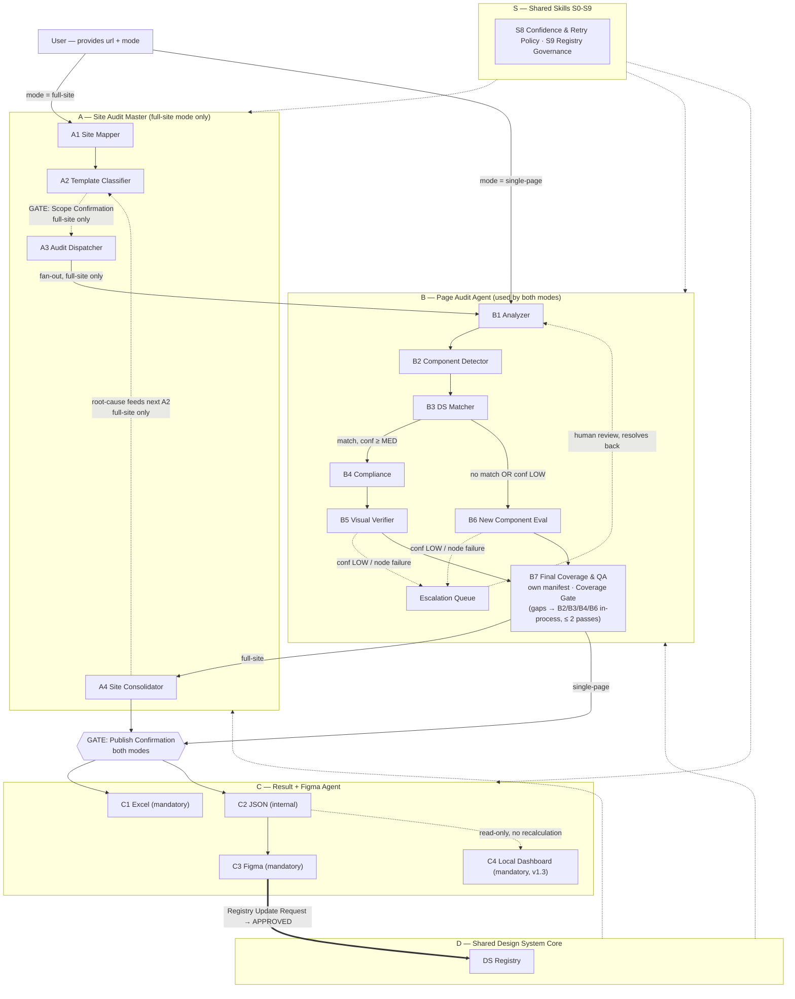

# AI Design System Audit Agent — Architecture v1.3

**Base:** `Ken_Research_AI_Design_System_Audit_Final_Architecture.pdf` (v1.0). **v1.1:** graph-engineering layer, confidence routing, feedback loops, responsibility refinement, entry contract (all additive). **v1.2:** failure/retry handling, concurrency-safe state, execution tracing, confidence calibration, real-page validation fixes, and the output/storage model. **v1.3 (this doc):** adds the Local Audit Dashboard as a third mandatory output (§6) — a new C4 node, explicitly directed, not a redesign of C1–C3.

**No node has ever been renamed, removed, or restructured across any of these passes.** Every addition through v1.2 was a new edge, a new state field, a new *shared skill* (S8, S9 — appended after v1.0's S0–S7), or a clarification of an existing node's responsibility — `A1–A4 / B1–B6 / C1–C3 / D1–D6` stayed exactly as v1.0 specified them. **v1.3 adds one genuinely new node, C4 Local Audit Dashboard**, alongside — not in place of — C1–C3, which remain untouched. C4 performs no independent calculation: it reads the same C2 JSON/Audit Data every other C-layer output reads, per §6 below. **A later, explicit upgrade adds the second genuinely new node, B7 Final Audit Coverage & QA (Decision Log #45)**: the last node of every page audit (`B1 → … → B6 → B7`), an independent final checker that verifies nothing meaningful on the rendered page silently disappeared. B1–B6 keep their roles and their code; B7 corrects a gap only by calling their own functions in-process (§5.2).

Status: architecture-only. No implementation code exists yet — that's a separate, later implementation plan (repo scaffolding for the actual A1–A4/B1–B6/C1–C3 code is not part of this document).

See also: [`RESEARCH-REFERENCES.md`](RESEARCH-REFERENCES.md) (54 sources this document's design choices are grounded in — cited inline as `#N`) and [`VALIDATION-NOTES.md`](VALIDATION-NOTES.md) (the real-page dry-run walkthrough that produced §2.7 and several §5 clarifications).

---

## 0. Entry Contract

Two inputs required at entry, every run, both modes:

| Input | Required | Notes |
|---|---|---|
| `url` | yes | site root for full-site, or the exact page URL for single-page |
| `mode` | yes, no default | `full-site` \| `single-page` — explicit enum, set by the caller |

**Hard routing rule: `mode` is the sole routing source of truth.** The system never infers or changes mode from `url`'s shape — pasting the homepage URL under `mode = single-page` audits exactly that one URL through B and nothing else; it does not trigger a crawl.

| `mode` | What runs |
|---|---|
| `full-site` | A1 → A2 → *(Scope Gate)* → A3 → parallel B → A4 → *(Publish Gate)* → C. Matches v1.0 §8. |
| `single-page` | B1 directly on `url` (matches v1.0 §9/§10) → *(Publish Gate)* → C. **A1–A4 are never invoked**, regardless of `url`. |

Validation: reject the request outright if `mode` is missing or `url` doesn't resolve — never fall back to guessing mode from URL structure.

**URL canonicalization (added — validated against a real page, see `VALIDATION-NOTES.md` §1):** before `url` is used to derive `page_id` (§2.5 rule 1) or the run-level key (§2.5 rule 6), it is canonicalized: prefer the page's own declared `<link rel="canonical">` / `og:url` when present; fall back to conservative generic normalization (protocol/case/trailing-slash/known tracking params only) when absent. Never strip a query parameter that could change rendered content — a confirmed real site had the same page linked from two different URL paths, and the canonical tag was the reliable signal, not string guessing.

---

## 1. Unchanged base

| Layer | Nodes | Role |
|---|---|---|
| A — Site Audit Master | A1 Site Mapper → A2 Template Classifier → A3 Audit Dispatcher → A4 Site Consolidator | full-site orchestration |
| B — Page Audit Agent (parallel instances) | B1 Page Analyzer → B2 Component Detector → B3 DS Matcher → (B4 Compliance Auditor → B5 Visual Verifier) \| B6 New Component Evaluator → **B7 Final Audit Coverage & QA** (Decision Log #45) | single-URL audit |
| C — Result + Figma Agent | C1 Excel Reporter, C2 JSON/Audit Data, C3 Figma Publisher, **C4 Local Audit Dashboard** (v1.3, §6) | downstream publishing only |
| D — Shared Design System Core | D1 Reader, D2 Registry, D3 Tokens, D4 Components/Variants, D5 States/Rules, D6 Version | single source of DS truth |
| S — Shared Skill Layer | S0 Result Contract … S9 Registry Governance | reusable knowledge, not agents |
| T — Deterministic Tools | Playwright, crawler, DOM/CSS extractor, screenshot engine, token comparator, DB | anything measurable is code |

---

## 2. Graph-engineering layer

### 2.1 Graph model

Edges are typed, not just arrows:
- `sequential` — B1→B2→B3, A1→A2→A3
- `conditional` — B3→B4/B5 vs B3→B6, declared as a predicate (`match_found == true`)
- `fan-out` — A3→B[1..N], bounded concurrency (§2.3)
- `fan-in` — B[1..N]→A4
- `feedback` — writes into upstream/shared state rather than only passing forward (§4)
- `gate` — pauses the graph pending an external (human) decision (§4.2)
- `error` — fires on node failure (tool error/timeout, or AI output failing S0 schema validation). Routes through classification (§2.4) → retry → escalation, never a silent drop.

**B7 is the final `sequential` edge of a page audit (`B5`/`B6` → `B7`).** Its corrections are NOT `feedback` edges and form no in-run cycle (Decision Log #13 stands — feedback is cross-run only): like B5's recovery, B7 re-uses B2/B3/B4/B6's own functions in-process for a gap, at most twice per item, and then settles the item as `NEEDS_REVIEW`. The graph stays a DAG.

### 2.2 Graph State (run-level, separate from S0's per-finding contract)

| Field | Purpose |
|---|---|
| `run_id`, `run_type` (`full-site`\|`single-page`), `started_at`, `ds_registry_version`, `policy_version` | identity. `run_type` set directly from §0's `mode`. `policy_version` — S8/S9 policy snapshot at run start (confidence bands, the audit engine's behaviour revision `engine-r<N>` — Decision Log #39 — the execution mode and the exact browser build), so a finding is traceable to exactly which rules produced it (a re-audit REGRESSION should never be confused with a policy change). |
| `status` | `PLANNING → AWAITING_SCOPE_CONFIRMATION → DISPATCHING → RUNNING → AWAITING_PUBLISH_CONFIRMATION → CONSOLIDATING → PUBLISHING → COMPLETE` |
| `scope` | template families, page count, estimated B-instance count (A2 output, read by the Scope Gate) |
| `checkpoints[]` | `{name, status: PENDING\|APPROVED\|REJECTED, decided_by, decided_at}` (§4.2) |
| `escalation_queue[]` | finding/node refs awaiting human review, `reason: LOW_CONFIDENCE \| NODE_FAILURE` (§3, §2.4) |
| `fan_out` | `{dispatched, completed, failed, retrying}` for the current B-instance batch |
| `cache_hits` | pages skipped via unchanged-since-last-audit memoization (§4.4) |

**D reads are cached once per run**, keyed to `ds_registry_version` — never re-fetched independently by each of N parallel B instances (avoids rate-limit pressure, ref `#31`; guarantees every B instance in a run sees an identical registry state).

**Page-level restart.** On restart after a crash, A1/A3 check `fan_out`/S7 state and redispatch only pages that never reached a terminal state — reuses infrastructure already defined. Deliberately not full node-level checkpointing: re-running one page's B1–B6 is cheap, and a full durable-execution engine (LangGraph/Temporal-style, `#1 #3`) was evaluated and not adopted for a narrower benefit (Decision Log #1).

### 2.3 Execution requirements (engine-agnostic)

A conforming engine must support: bounded-concurrency fan-out, conditional edges with typed predicates, shared mutable state, pausable/resumable execution at `gate` edges, and retry with classification (§2.4). Candidate engines (not locked in): a LangGraph-style state graph `#1 #2`, or Claude Code's `Workflow` tool for CLI-driven runs.

### 2.4 Failure & Retry Policy

**Error classification, before any retry decision:**

| Class | Meaning | Action |
|---|---|---|
| `RETRYABLE` | transient (network timeout, rate limit, tool flake) | retry per policy below |
| `REPAIRABLE` | output wrong/malformed but fixable on the same input (e.g. AI node returns schema-invalid JSON) | one bounded repair attempt (re-ask with the validation error) before it counts as a normal retry |
| `TERMINAL` | retrying/repairing can't help (404, fundamentally unparseable input) | skip straight to exhausted-retry escalation — don't burn retry budget |

**Retry policy, by actual execution type** (lives in skill **S8**, whose scope covers both confidence-triggered and failure-triggered escalation — not two separate skills):

| Execution type | Nodes | Max attempts | Backoff | Typical failure mode |
|---|---|---|---|---|
| Deterministic/tool | T-layer (Playwright, DOM/CSS, screenshots) + A1, A3, C1, C2, **B7** (deterministic in every AI mode) | 3 | exponential + jitter, 2s base | network flakiness, page not ready |
| AI | B1, B2, B3, B5, B6, A2, A4 | 2 | exponential + jitter, 5s base | schema-invalid output (`REPAIRABLE`), timeout |
| Hybrid (deterministic + AI step in one node) | B4 Compliance Auditor, C3 Figma Publisher | 2, retrying only the failed sub-step | exponential + jitter, matching the failed sub-step | token-comparator failure (`RETRYABLE`) vs. layout/interpretation failure (often `REPAIRABLE`) |

Jitter (`#9`) is included specifically because N parallel B instances can hit the same failure simultaneously (fan-out) — backoff without jitter retry-storms in lockstep.

**Exhausted-retry escalation.** Appends to `escalation_queue[]` with `reason: NODE_FAILURE` (alongside `reason: LOW_CONFIDENCE`, §3) — same queue, same S8 policy. B-instance failures also land in v1.0's own §15 Excel tab "09 Failed / Skipped Pages."

**Partial fan-in.** One B instance exhausting retries never blocks siblings. A4 only requires `fan_out.dispatched == fan_out.completed + fan_out.failed` before consolidating.

**Failure Threshold Gate, with half-open auto-retry** (`#11 #12` — full-site mode only, reuses the `gate` edge type and `checkpoints[]`). If the batch failure rate crosses a threshold (default 20%), the run first tries a small trial batch automatically after a cooldown — only pauses for a human if the trial also fails.

**Network-noise scoping (validated against a real page, `VALIDATION-NOTES.md` §2).** This classification applies only to the current page's critical-path resources. Prefetch/speculative requests for *other* routes (e.g. a Next.js hover-prefetch of an unrelated page) are filtered out before reaching `RETRYABLE`/`REPAIRABLE`/`TERMINAL` classification — confirmed necessary: a real page audit observed a `net::ERR_ABORTED` on a prefetch for a completely different page while the current page rendered fine.

**Console-message noise policy** (same principle, for console output — `VALIDATION-NOTES.md` §3): explicit filtering so real signal (e.g. a third-party library misconfiguration warning relevant to a DS component) isn't buried under routine preload/performance noise. Only error-level messages and specific known-meaningful warning patterns feed into B4/B5 evidence.

**Gate timeout.** Scope/Publish/Failure Threshold gates all auto-escalate to a fallback reviewer on timeout (`#4 #8`) — never auto-approve, never auto-reject.

### 2.5 Concurrency-Safe Shared State

No locking service, no consensus protocol, no new agent:

1. **Namespaced, disjoint writes.** Every `escalation_queue[]` entry and every S0 finding record is keyed by **`(run_id, page_id, node_id, finding_id)`** — `finding_id` is required because one node execution (e.g. B2 on a page with 12 components) can produce multiple findings; a 3-part key can't address them individually. `#16`
2. **Atomic counters, not read-modify-write.** `fan_out.{dispatched,completed,failed,retrying}` increment atomically, or are summed at read-time from an append-only per-instance event log — never "read, add one, write back." `#17 #18 #19`
3. **Content-addressed dedup for Registry Candidates.** B6 computes a deterministic signature (canonical sorted-key serialization, then a stable hash — not a naive `JSON.stringify`, which isn't key-order-stable, `#20 #21 #22 #23`) for structure + detected props/variants before creating a Registry Update Request. A request with a matching signature already `PROPOSED`/`UNDER_REVIEW` absorbs the new occurrence as evidence instead of duplicating.
4. **Idempotent writes cover retries too, per execution type.** Deterministic/tool-class retries cache and replay the first result on a matching key (`#13 #14`). AI-class retries re-run fresh rather than being locked to a possibly-bad first attempt — dedup happens on the *final* write, same key, so exactly one record lands. Hybrid nodes apply whichever rule matches the failed sub-step. `#15`
5. **Extends to C3's Figma writes.** The same idempotent-key principle covers re-publishing on a re-audit — satisfies v1.0's own §11 "avoids... duplicate frames." `#33 #36 #37`
6. **Run-level concurrency guard.** A run registry keyed by `(url, mode)` rejects (or queues) a new request against a target that already has a `RUNNING` run — prevents two overlapping full-site audits of the same site from racing each other's D2/S7 writes. `#16`

Fan-in completeness (§2.4 — A4 waits for `dispatched == completed + failed`) is what makes rule 1 sufficient alone.

### 2.6 Execution Tracing

Adopts **OpenTelemetry's trace/span model and GenAI Semantic Conventions** (`#45 #46 #47 #48`) — not a bespoke log schema, so it's interoperable with any standard observability backend. Persists into the T-layer **Audit Database/History** tool as a table distinct from S7 (S7 = audit-domain history/findings; this = graph-execution history/spans). This is what gives `reason: NODE_FAILURE` an actual diagnostic trail.

### 2.7 Render-Settled & Dynamic-Content Preconditions

*(New in v1.2 — found by testing the graph against real pages; see `VALIDATION-NOTES.md` for the evidence.)*

**Per-instance browser isolation.** Every parallel B instance gets its own Playwright `BrowserContext` (`#27`) — no cookies, storage, session, or autofill state is shared between concurrent page audits or carried across runs.

**Render-settled precondition.** B1 waits for network-idle (bounded timeout) before capturing DOM/screenshots — confirmed necessary: a real page fired 11+ async API calls (auth session, product data, CMS collateral) after initial load. Deterministic, T-layer concern. `#24`

**Dynamic content settling — primary mechanism is confidence-flagging, not just waiting.** Tested directly: scrolling a count-up stat counter into view, dispatching a real scroll event, and waiting 3 seconds did **not** make it render its real value — it stayed at its placeholder ("0+"). Network-idle alone doesn't cover this either (animation timing isn't network-bound). So the design is: (a) attempt a bounded settle-and-recheck (scroll-into-view + wait + re-read) as a first pass, but (b) treat this as insufficient on its own — any numeric-looking placeholder value (`0+`, `$0`, `0%`) that persists after settling is automatically flagged **LOW confidence via S8** and routed to the escalation queue, rather than either trusted as real content or silently discarded. This is deliberately ambiguous-by-design: the agent cannot always tell whether a persistent placeholder is a genuine site bug (worth surfacing) or an animation trigger it can't reproduce — confirmed as a real, cross-template pattern (the same signature appeared on two unrelated page templates during validation), so it's modeled as a recurring signature, not a one-page anomaly.

**Evidence correction (Phase 2 T-layer build, 2026-09-11):** the "did not resolve" test above dispatched a *synthetic* `scroll` event, which neither moves the scroll position nor re-runs `IntersectionObserver`. With *real* wheel input (`page.mouse.wheel`), the same counters on live kenresearch.com resolve to their real values on both affected templates (`0+`→`1000+`, `$0Mn`→`$500Mn`, `0+`→`250000+` — recorded in `test/fixtures/templates/`). The mechanism is unchanged — settle first, and anything that *still* matches the placeholder signature afterwards is flagged LOW via S8 — but settle-and-recheck is now evidenced to work in practice, and the LOW-confidence path is a backstop for genuine failures rather than the expected outcome.

**Interactive-disclosure expansion.** B1 expands recognized disclosure patterns (tabs, accordions, "Read More" truncation) for known DS components before capture, rather than only capturing whatever's in the DOM at load. Confirmed necessary on two different real templates: a tabbed report listing (Trending/New/Recently Updated, each a separate API-backed state) and a "Read More"-truncated report-detail chapter — both are the same underlying problem (content behind a disclosure control is invisible to a passive snapshot), unified into one mechanism.

**Personalized-content scoping.** Sections that are genuinely personalized per-visitor (e.g. a "Recommended For You" block) are documented as being audited in their anonymous/cold-start variant only — a direct, correct consequence of per-instance browser isolation (above). This is consistent run-to-run (no flaky diffs from browsing history), but is an explicit, named scope boundary rather than a silently-accepted blind spot: personalized sections are flagged as out of DS-compliance scope, not evaluated as if their cold-start rendering were the typical state.

**Bounded listing-sampling policy.** A2/B1 use an explicit sampling strategy for very large or infinite listings (confirmed real: a report-store page advertised 200,000+ items behind faceted filters) rather than assuming exhaustive enumeration. Concretely, B2 samples a repeated group (to `LISTING_SAMPLE_LIMIT` = 5) **only when it is a listing**: at least `LISTING_MIN_ITEMS` (12 — B1's own listing threshold) members in one section, or any group in a section B1 flagged as a listing. A smaller repeated group — a feature grid, a row of cards, a step list — is page structure and is audited in full, so no later row is silently skipped. What was sampled is reported (`sampled` of `totalObserved`), and B5 never re-captures what B2 sampled out (Decision Log #40).

---

## 3. Confidence routing

Shared skill **S8 — Confidence & Escalation Policy** (scope: confidence bands below, *and* failure-triggered escalation, §2.4 — one skill, two trigger reasons):

| Band | Default threshold | Applies to |
|---|---|---|
| HIGH | confidence ≥ 0.85 | auto-proceed |
| MEDIUM | 0.5 ≤ confidence < 0.85 | proceed, flagged distinctly in C1/C3 |
| LOW | confidence < 0.5 | route to escalation queue, not auto-classified |

**Applied at:** B3 (LOW confidence match routes down the B6 "no match" branch instead of a shaky Match/Deviation call), B5 (LOW confidence visual findings escalate instead of publishing), B6 (LOW confidence New-Component-vs-DS-Candidate calls escalate before reaching C3's Figma board).

**Calibration — lightweight sampling** (`#52` — raw model confidence is well-documented as often overconfident unless validated; `#8` — the sampling-even-high-confidence pattern). S8 includes a sample-rate policy: some percentage of HIGH-confidence auto-proceeds are randomly pulled into the Publish Gate review alongside actual LOW-confidence escalations, so drift gets caught by the humans already in the loop. No automated calibration-tracking system — deliberately deferred until enough audit history exists to make it meaningful.

**New S0 fields (additive, backward-compatible):** `confidence_band`, `escalation_status` (`NONE|QUEUED|IN_REVIEW|RESOLVED`), `registry_update_ref` (§4.1).

---

## 4. Feedback loops

### 4.1 DS Candidate → Registry write-back loop

A **Registry Update Request** record (`{candidate_ref, proposed_by: B6, status: PROPOSED → UNDER_REVIEW → APPROVED|REJECTED → MERGED, reviewed_by, merged_at}`) is created when C3 publishes a DS Candidate board, tracked in S7, and — on `APPROVED` — written into D2 Registry (bumping D6 Version). Governed by shared skill **S9 — Registry Update Governance** (who can approve, what "MERGED" requires, how D6 increments). Only **B6** (proposes) and **C3** (executes the merge) touch S9.

### 4.2 Mid-run human checkpoints (`gate` edges)

- **Scope Confirmation Gate** — full-site mode only, after A2/before A3. Reviewer sees `scope` (template families, page count, estimated B-instance count), approves or adjusts. Skippable for trusted re-audits. Doesn't exist in single-page mode.
- **Publish Confirmation Gate** — both modes, immediately before C3 writes, regardless of source (Master Result after A4, or Current Page Result/re-audit delta straight from the B-graph). Keyed to "before C3," never to A4, since A4 doesn't run in single-page mode.
- **Failure Threshold Gate** — see §2.4.

All three are `checkpoints[]` entries; all three timeout to a fallback reviewer, never auto-approve/reject.

### 4.3 Root-cause → reclassification loop

A4's root-cause clusters feed back into A2's input for the *next* run, refining template classification over time.

### 4.4 Re-audit loop, with memoization

Each page audit checks S7 right after capture (Decision Log #26) — if the page's DOM hash and the DS registry version are both unchanged since its last audit, and so is the audit policy — which includes the audit **engine's behaviour revision** (Decision Log #39) and the browser build — and nothing in that result was left unverified **and its Coverage Gate passed** (B7, Decision Log #45 — a stored result with no coverage ledger, i.e. an audit that predates B7, or with anything unaccounted, is never reused; a reused page carries its ledger), it reuses the prior result instead of re-running B1–B7 (a `cache_hit`). A page last audited by an older engine revision is therefore audited again, never handed its old findings. Same NEW ISSUE/STILL OPEN/RESOLVED/REGRESSION delta model, cheaper at scale; what a delta may claim is fixed by Decision Log #29.

All four loops above operate **across runs**, not as in-run cycles — deliberately, to keep a single execution a DAG (plus pause/resume gates) rather than introducing intra-run re-computation cycles.

---

## 5. Agent/skill responsibility refinement

### 5.1 Internal phase split inside A

A's two implicit jobs — *deciding what to audit* (A1, A2) and *making the audit happen* (A3, A4) — stay one box in the diagram, but the Scope Confirmation Gate sits exactly on that seam.

### 5.2 Responsibility matrix

| Node | AI or deterministic? (in `anthropic-api` mode — every AI node is deterministic in the default `no-api` mode, §5.4) | Reads (D) | Reads (S) | Notable behavior |
|---|---|---|---|---|
| A1 Site Mapper | deterministic | — | S2, S8 | canonicalizes URLs (§0); cache-checks before dispatch (§4.4) |
| A2 Template Classifier | AI | — | S2, S3, S8 | reads prior root-cause clusters (§4.3) |
| A3 Audit Dispatcher | deterministic | — | S7, S8 | honors Scope Gate; writes `fan_out` |
| A4 Site Consolidator | AI | — | S5, S7, S8 | honors Publish Gate; root-cause grouping |
| B1 Page Analyzer | AI | — | S2, S8 | expands disclosure controls before capture (§2.7); capture waits on the T-layer render-settled precondition (§2.7) |
| B2 Component Detector | AI | D4 | S3, S8 | **must use combined DOM + rendered-visual evidence, never ARIA/role alone** — confirmed on a real page that a semantically meaningful control had no ARIA role at all; excludes off-domain utility links from detection scope unless they match a recognized DS CTA pattern |
| B3 DS Matcher | AI | D2, D4 | S4, S8 | writes `confidence_band` |
| B4 Compliance Auditor | AI + deterministic (token comparator) | D3, D5 | S5, S8 | **consumes B2's exact resolved element reference — never re-derives its own selector independently.** Confirmed necessary: an independent re-query on a real page grabbed the wrong DOM node and produced a confident-but-wrong measurement. |
| B5 Visual Verifier | AI | — | S6, S8 | writes `escalation_status` |
| B6 New Component Evaluator | AI | D4 | S3, S8, S9 | writes `escalation_status`; computes dedup signature (§2.5 rule 3 — S3's scope extended to cover this); proposes Registry Update |
| B7 Final Audit Coverage & QA | **deterministic in every mode** (§5.4) | D2, D4 (through B3/B4/B6) | S0, S7, S8 | **builds its OWN Coverage Manifest of the rendered page — never B2's candidate list alone** (DOM, accessibility tree, visible text, computed style, geometry, interaction state); every discovered item ends in exactly one of `AUDITED` / `EXCLUDED_WITH_REASON` / `NEEDS_REVIEW` / `CAPTURE_FAILED`; routes each gap to the stage that owns it (missing element → B2, wrong role → B2/B3, wrong family → B3, missed property → B4, no family → B6, interaction-revealed content → a layer reveal, then the normal flow); **a recovery LOOP (#47)**: the unaccounted items alone go back through those stages, the manifest is rebuilt and B7 runs again until `unaccounted = 0` — 2 attempts per item, then an explicit reasoned state (excluded · needs review · capture failed), convergence detection and safety limits; re-derives every text item's role from the whole section hierarchy; publishes the **Coverage Gate** (passes only when `unaccounted = 0`) |
| C1 Excel Reporter | deterministic | — | S0, S8 | mandatory deliverable (§6 Output Model) |
| C2 JSON/Audit Data | deterministic | — | S0, S7, S8 | internal-only (§6 Output Model) |
| C3 Figma Publisher | deterministic + AI (layout) | — | S0, S8, S9 | honors Publish Gate; executes approved Registry Update; mandatory deliverable |

### 5.3 Shared skills (appended after S7 — S0–S7 unchanged)

| Skill | Purpose |
|---|---|
| S8 — Confidence & Escalation Policy | band thresholds (§3), sampling (§3), failure-triggered escalation and retry policy (§2.4) |
| S9 — Registry Update Governance | Registry Update Request lifecycle (§4.1) |

### 5.4 Execution modes — `AI_MODE` (Decision Log #31)

Every node marked "AI" in §5.2 has **two strategies behind the same graph node** — same inputs, same outputs, same edges, gates, retries, tracing and storage. Only what happens inside the node differs. The mode is chosen once per run (`AI_MODE` env / `aiMode` in `audit-agent.config.json`) and recorded in `policy_version` (`…+ai-no-api+…`) and C2's `run.aiMode`.

- **`no-api` — the v1 default.** Deterministic: zero model API calls, no credential needed or read. The model client is a `DisabledLlmClient` that fails a run TERMINAL if anything ever calls it. What cannot be proven without semantic judgment is published as **NEEDS_REVIEW** or **UNVERIFIED** (S0, additive) with the reason, confidence, evidence, element/component and possible DS matches — never guessed in either direction, never scored.
- **`anthropic-api` — optional.** The Claude path built for step 11, isolated behind `LlmClient` (`src/llm/`). Disabled unless explicitly configured; refuses to start without `ANTHROPIC_API_KEY`.

| Node | no-api strategy |
|---|---|
| A2 Template Classifier | families from URL shape (same first path segment + same depth); the Scope Gate reviewer merges if needed |
| A4 Site Consolidator | deterministic clusters — same DS rule broken, same DS token missed, same DS component deviating — reported only across ≥ 2 issues or pages; never an invented cause |
| B1 Page Analyzer | the DOM's section spine: wrappers taller than half the page are expanded into their children; the page root is never a section. B1 **owns section membership**: content a section holds in its DOM subtree but renders outside its own y-range (a sticky scroll stage's overflowing list) is adopted by that section and handed to B2 explicitly (`adoptedRefs`), instead of being left "never offered" (#40) |
| B2 Component Detector | candidates from the accessibility tree (controls, headings, clickables) **plus non-interactive badges** (a small, childless, text-bearing leaf that is bordered or filled — `isBadgeCandidateShape` + `badgeSignal`; plain body text and display-size numerals are candidates too — `paragraph` / `stat`, decided from the section's text hierarchy (#43, #44)); type from role + the element's own computed style (a link painted as a button is a button); off-canvas carousel slides / closed drawers are audited from their computed styles (stated as not pictured), so the audited set — and the re-audit history — does not depend on which slide happened to be showing. A repeated group is **sampled only when it is a listing** (≥ 12 members in a section, or a B1-flagged listing); smaller groups are audited in full. B2 reports every ref it decided about (`decidedRefs`) so B5 never re-captures what it declined (#40). Two types are decided from the element's own visible STRUCTURE, with no role behind them: a bordered/filled text leaf is a `badge`; a repeated, card-scale non-interactive block (B5's second look, `classifyCandidate` with `repeatedBlock`) is a `card` only when it has a visible surface (border, fill, background image or shadow) — a bare one is a layout column, excluded with its reason. Both carry `structural` (LOW confidence — no role — yet the structure IS the pattern the DS family is defined by), so B3 may claim that family (#41) |
| B3 DS Matcher | (1) **class fingerprint** — the element's classes against every DS component's own source classes, weighted by rarity; (2) **DS-rule mapping** (R4.1 Button, R4.2 Link, R4.3 Card…) confirmed only when the rendered style fits one of the component's variants on ≥ 70% of governed properties; (3) **family identity**, settled before visual compliance — the DS rule names the family for the element's type (R4.6 Badge, R4.3/R4.4 Card, R4.1 Button…), so an existing family with wrong styling is that component with deviations, never undecided: the rule's own files are searched first, then the rest of the family (Badge/Tag/Chip/Pill/Label/Status; the other R4.4 cards) before "no family" is ever said; a LOW-confidence STRUCTURAL type may claim its family (a doubtful TYPE — an unlabelled clickable inferred to be a button — may not); a variant that itself paints brand red is never named the closest for a non-CTA (R1.2). Only an element no family member can represent is undecided → B6 → NEEDS_REVIEW with every candidate and why. Every answer records the family searched and its basis (`DsMatch.search`) for B5 to verify (#41). A section heading's DS level is the one whose size is **nearest the rendered size**, never its h1/h2/h3 tag (#38). Only when the DS search is undecided for a role, the approved Project Aura reference evidence for that role (`reference/approved-reference-patterns.json`) is attached as a **verdict** — consistent / single-source / divergent — never as a decision and never forcing a DS component (#46) |
| B4 Compliance Auditor | expectations read from the matched component's **own source** per variant (`src/ds/component-styles.ts` — root className/style data flow, Tailwind v4 semantics resolved through the DS tokens); every equally-fitting variant is compared and a property deviates only if it matches none; foundation rules measured (R1.2 brand red on headings **and as a border or fill on any non-CTA element**, R1.3 type scale, R1.4 typefaces, R3.5 spacing scale, R3.6 radius scale) — each scale check cites the single nearest step of its own token family and never overrides a property the matched variant already resolved (#38) — except R1.2, a prohibition rather than a scale: for an element matched only by family identity (it does not conform to the variant) the brand-red citation stands whatever the variant says about that colour (#41); nothing comparable → UNVERIFIED |
| B5 Visual Verifier | no visual verdict (stays NOT_CHECKED — measured findings stand on measurement); attaches measurable layout/accessibility facts (text cut off by its box, target below 24×24px). In no-api mode B5 is also the **final completeness/verification stage** — no new node or edge, and the graph order stays B4 → B5 → B6. In at most 2 passes it checks (1) **element coverage → B2**: a candidate nobody accounted for (a badge-shaped leaf, a repeated card-scale block) is classified by B2, captured, then routed exactly like a first-pass element — B3 searches its Design System family; B4 audits it against that component's full contract, or — only when no existing family represents it — B6's own evaluation (`evaluateUnmatched`, the function the B6 node runs) produces its finding, and the B6 node never sees it twice; (2) **DS-matching coverage → B3**: B3's recorded family search is verified against the family the DS names for the type (a missing record, the wrong family, a component outside the family with no class evidence) and a flagged answer is re-asked and the element re-routed to B4 or B6; (3) **property coverage → B4**: foundation rules AND the matched variant's full contract are recomputed and a gap rebuilt via B4's `buildFinding`. At most 2 attempts per item; valid non-candidates are informational; capture failures and unresolved references are coverage errors AND NEEDS_REVIEW findings; whatever is unresolved after the cap is marked NEEDS_REVIEW (#40, #41) |
| B6 New Component Evaluator | a measured foundation-rule breach → INCORRECT (those rules govern every element, whatever component it is); a repeated pattern on DS foundations with no plausible DS equivalent → DS_CANDIDATE, filed PROPOSED (never auto-approved); everything else → NEEDS_REVIEW. NEW_COMPONENT is never decided without a model. B6 is for a pattern **no existing DS family** represents — never an existing component with wrong styling (that is a B4 deviation). Its evaluation lives in `evaluate.ts` so the B6 node (B3's first-pass unmatched) and B5 (a recovered element B3 found no family for) run the same code (#41). A role the approved Project Aura pages use **consistently** (≥ 2 pages, nothing differing) but the DS does not define is a **reference-backed DS_CANDIDATE** proposed for governance; single-source or divergent evidence is NEEDS_REVIEW with the pages' own values beside the measurement (#46) |
| B7 Final Audit Coverage & QA | deterministic in every mode — it never calls a model. It re-uses B2's classifier and capture, B3's matcher, B4's evaluation and B6's evaluation through the same shared helpers B5 uses (no parallel re-implementation) and the safe-click predicate of B1's disclosure expansion for every reveal. In `anthropic-api` mode (a model typed the components) it only **accounts** — gaps become `NEEDS_REVIEW`, no corrective stage runs and roles are not judged by the deterministic classifier (#45). In `no-api` mode it is the convergent recovery loop of #47 |
| C3 Figma Publisher | the deterministic publish plan is built as always; the Figma write itself is a headless Claude Code run (a model client), so it is not started in no-api mode |

---

## 6. Output Model

**Three mandatory outputs, every completed run — starting with the very first one.** Not a primary/secondary hierarchy:

| Output | Role | Mandatory from run 1? |
|---|---|---|
| **Figma** | Primary *visual* output — screenshots, findings, issue markers, summaries, component/page audit results | **Yes** |
| **Excel** | The *complete structured* audit report — full findings across all tabs | **Yes** |
| **Local Audit Dashboard** (C4, **v1.3**) | Interactive local review of the same findings — no separate deliverable file, no independent calculation | **Yes** |
| **JSON** | Internal/backing data only — what re-audit diffing, Figma generation, Excel generation, **and the dashboard** all read from. Never presented as "the report" itself. | Yes, internal-only |

Raw screenshots are backing data that populate Figma's visual pages, not a deliverable on their own.

**Figma pages** (extends v1.0 §16 with one new page, marked **new**): `00 Overview` · `01 Template Summary` · `02 Global Issues` · `03 Page Audits` (screenshots + numbered issue markers linked to issue cards) · `04 Component Audit` · `05 New Components` · `06 DS Candidates` · **`07 Re-Audit History`** (NEW ISSUE / STILL OPEN / RESOLVED / REGRESSION deltas across a project's runs, visually browsable, not only in local JSON).

**Coverage ledger & gate (Decision Log #45).** C2's `data.json` records, per page, the B7 ledger (`coverage[].ledger` — the gate and per-kind counts, every exclusion grouped by its stated reason, every needs-review / capture-failed / unaccounted item in full with its state, reason, section, box and text, the corrective actions taken, the role-check tally and the sources the manifest was built from; audited items are counted, not listed one by one) and, across the run, `coverageSummary.gate` (+ `pageSummary[].coverageGate`): `discovered · audited · excluded (by reason) · needs review · capture failed · unaccounted`. Every output only READS it — nothing recomputes it: the HTML report and dashboard (`html-report-v13`) show ONE compact line under the Summary — `Coverage: PASSED · 473 discovered · 473 accounted · 0 unaccounted` (or `INCOMPLETE · 473 discovered · 227 remaining`) — with the whole ledger (the numbers, recovery passes / recovered items, every exclusion, review, failure and remaining item with its reason) inside a COLLAPSED `Coverage details` accordion; the Figma `00 Overview` page gets a `Coverage gate` tile (`figma-layout-v6`, unchanged), the Excel summary a row, and the CLI prints `Coverage: RECHECKING · N discovered · R remaining` while B7 re-checks and `Coverage gate: …` after every audit, exiting with code 3 when it is INCOMPLETE. A run that predates B7 shows "not recorded", never a pass. The ledger also carries the loop's own account (`ledger.recovery`: passes · found · recovered · settled · remaining · why it stopped).

### C4 Local Audit Dashboard (**new, v1.3**)

**Why this exists:** Figma and Excel are both complete, but neither is a fast local review surface — Figma needs the Figma app/web client and a network round-trip per view change; Excel needs opening a spreadsheet and manually cross-referencing tabs. The dashboard is the fast, local, filterable view of the exact same audit result.

**Hard constraint (explicitly directed, not a design preference): C4 performs zero independent calculation.** It is a *read-only view* over the same C2 JSON/Audit Data (`runs/<run_id>/data.json`, backed by the `findings`/`escalation_queue`/`fan_out`/`audit_history` tables in the SQLite store) that C1 and C3 already read. C4 must not write to the run's data at all; it is display-only, same posture as C1.

**C2 is the single canonical source of truth for all three outputs (Decision Log #19) — no output is another output's oracle.** Correctness for the Dashboard, Excel, and Figma is each verified *independently against C2*, never by comparing them to each other. Two outputs agreeing with each other while both disagreeing with C2 is still a failure — cross-output comparison alone cannot catch that, which is why it is explicitly rejected as the verification strategy in favor of three separate C2-parity checks (see `IMPLEMENTATION-PLAN.md` §9).

**Access model:** one local URL per project/run — `http://localhost:<port>/projects/<project-name>/runs/<run_id>` — served by a local process on the machine running the audit, not a hosted/deployed surface. No new files are written to `runs/<run_id>/` for this — C4 reads `data.json` directly at request time.

**Required views**, all derived from the same S0 finding records and Graph State already defined in §2.2/§5's S0 Result Contract — no new data model:
- **Summary** — run-level rollup (page/component counts, MATCH/DEVIATION/INCORRECT/NEW_COMPONENT/DS_CANDIDATE breakdown, escalation-queue size)
- **Compliance** — per-page and per-component compliance status
- **Issues / Deviations / Incorrect matches** — filterable by classification, matching S0's `classification` field exactly
- **Severity** and **Confidence** — filterable/sortable by S8's confidence bands and any severity field S0 carries
- **Pages** and **Components** — browsable by `page_id` / detected component identity
- **Screenshots and evidence** — the same `screenshots/` evidence C3 uploads to Figma, served locally instead of proxied through Figma

Full implementation-level detail (tech choice, routes, module structure, build-sequence placement) is in the Phase 2 plan, not this architecture document — matching how C3's implementation-level detail also lives in `IMPLEMENTATION-PLAN.md` rather than here.

### Storage — Project → Runs

Every audit target is a **project**, created on its first audit. Every execution or re-audit of that target is a **run** inside it:

```
projects/<project-name>/
├── project.json          ← persists this project's Figma destination + target config
│     { target_url, mode, figma_file_key, figma_file_url,
│       figma_team_plan_key, created_at }
└── runs/
    └── <run_id>/
        ├── report.xlsx     ← C1 — mandatory deliverable
        ├── data.json       ← C2 — internal/backing data; also what C4's dashboard reads live, at request time
        ├── screenshots/    ← B5 evidence, backing data for Figma's visual pages AND served locally by C4
        └── history/        ← S7 — baselines re-audits (local and Figma §07) diff against
```

C4 (dashboard) writes nothing new here — it is a read-only server process reading `data.json`/`screenshots/` for whichever project/run its URL addresses.

`project.json`'s persisted Figma file key means every run of a project — including future re-audits — updates the *same* Figma file automatically, rather than creating a new one each time. Recommended default: `runs/` is `.gitignore`'d (large, frequently-changing binaries don't belong in the code/docs repo's git history) — this is a git-hygiene choice, not a statement that Excel is optional.

### Figma auto-create capability (verified against the connected Figma MCP, not assumed)

`create_new_file` can create a new blank Figma file automatically on a project's first run — no pre-existing target file is required. It needs a `planKey` identifying which team/org owns the file. At verification time, the connected account had two teams: one with a **Full** seat (pro tier — can create files) and one with a **View**-only seat (starter tier — cannot). **Decided (Decision Log #16): audit-agent Figma files are owned by "Digital Kenresearch's team"** (`team::1364202946001928079`, pro tier, Full seat). Stored as configuration, not hardcoded in code, and copied into each project's `project.json` as `figma_team_plan_key` when that project's Figma file is first created.

### Repository & Design System access

- This repo (`/Users/sachin/Project-aura/audit-agent/`) is standalone, with its own `.git` — a sibling to `project_aura1-main/`, not nested inside it. It is the single source of truth for Audit Agent docs and workflows.
- **D1 DS Reader** reads the existing Design System through a **config-based source path with environment override** (Decision Log #17): the repo's config file declares the path, defaulting to `/Users/sachin/Project-aura/project_aura1-main/design-system/`; an environment variable overrides it when set (e.g. a different machine or a deployed environment). Never a hardcoded path in code; never vendored, copied, or snapshotted into this repo. Extends v1.0's D-layer boundary rule ("every audit reads the same registry/version, never duplicated") across the repo boundary.
- **D3 Tokens** uses that Design System's existing **Style Dictionary v4 DTCG** output (`design-system/tokens/`, `#38 #39`) as its token representation — not a separate schema.

---

## 7. Diagram



*Not shown for clarity: `error`/retry edges, jitter, half-open retry, and concurrency-safety keys apply uniformly to every B instance — see §2.4/§2.5 for precise mechanics rather than cluttering the diagram.*

---

## What changed, v1.0 → v1.3

| Area | v1.0 | v1.2 |
|---|---|---|
| Entry / mode selection | implicit (slash command choice) | explicit `mode` input, sole routing source of truth, URL canonicalization (§0) |
| Graph formalism | "graph-engineered flow" (decision, no schema) | typed edges incl. `error` (§2.1) + Graph State (§2.2) |
| Confidence field | present in S0, unused | S8 policy + routing + calibration sampling (§3) |
| DS Candidate | reported outward, no loop back | Registry Update Request loop into D2, governed by S9 (§4.1) |
| Human checkpoints | one, pre-build, outside the graph | Scope/Publish/Failure Threshold gates inside the graph, all with timeout behavior (§4.2, §2.4) |
| Failure/retry | mentioned in prose only | classified (`RETRYABLE`/`REPAIRABLE`/`TERMINAL`), typed by execution class, jittered, escalated (§2.4) |
| Concurrent shared state | undefined | namespaced 4-part keys, atomic counters, content-addressed dedup, run-level guard (§2.5) |
| Dynamic/real-page behavior | not addressed | render-settled preconditions, disclosure expansion, personalization scoping, listing sampling (§2.7) |
| Execution observability | not addressed | OpenTelemetry-based tracing (§2.6) |
| Output model | Excel/JSON/Figma listed, no priority stated | Figma + Excel both mandatory from run 1, JSON internal-only, Project→Runs storage (§6) |
| Repository location | not addressed | standalone sibling repo, configurable DS-source path, no duplication (see this repo's own structure) |
| Nodes A1–A4/B1–B6/C1–C3/D1–D6 | — | **unchanged** |

**v1.2 → v1.3:**

| Area | v1.2 | v1.3 |
|---|---|---|
| Output model | Two mandatory outputs (Figma, Excel) + internal JSON | **Three** mandatory outputs — adds the Local Audit Dashboard (C4), reading the same C2 JSON, zero independent calculation (§6) |
| Nodes | C1–C3 | **+ C4 Local Audit Dashboard** (new node, additive only — C1–C3 unchanged) |

**After v1.3 (Decision Log #38–#46, engine revisions 1–5):**

| Area | Before | After |
|---|---|---|
| Nodes | B1–B6 | **+ B7 Final Audit Coverage & QA** — the last node of every page audit; B1–B6 unchanged in role (#45) |
| What "covered" means | B2's candidate list (+ B5's recovery of what B2 left unaccounted for) | an **independent Coverage Manifest of the rendered page**, every item in exactly one state, a **Coverage Gate** that passes only when `unaccounted = 0` (#45) |
| Heading identity | the h1–h3 tag | the role decided from the section's whole text hierarchy first (eyebrow / main heading / description), then the DS family (#44); validated again by B7 (#45) |
| Where the DS has no pattern | undecided → B6 | Design System first → closest valid family/variant → approved Project Aura reference **evidence** (engine code, #46) → NEEDS_REVIEW → B6 only for a genuine no-family/no-pattern |
| Report templates | `html-report-v11` / `figma-layout-v5` | `html-report-v19` / `figma-layout-v6` — findings listed in reading order inside each section (v19: top to bottom, left to right, from the stored evidence box — `src/output/reading-order.ts`, display only); the Coverage Gate on every output surface, compact in the HTML Summary (v13); findings grouped by structural region — Global Header with its sub-groups, page sections, Global Footer (v14); Global Header / Global Footer as collapsed-by-default accordions with disclosure buttons, opened by a filter that targets them (v15); the accordion's chevron at the far right of the row — right when collapsed, down when expanded, vertically centred (v16) |
| B7's recovery | reported what was unaccounted | a convergent **recovery loop**: unaccounted items re-audited through B2/B3/B4/B6 round after round, manifest rebuilt each time, until `unaccounted = 0` or convergence (#47) |

---

## Decision log

| # | Question | Decision | Why |
|---|---|---|---|
| 1 | Node-level durability | Page-level restart only, not per-node checkpointing | Re-running one page's B1–B6 is cheap; a full durable-execution engine is real cost for a narrower benefit |
| 2 | Confidence calibration | Lightweight sampling, not automated calibration tracking | No new infrastructure; not enough audit history yet to make automated calibration meaningful |
| 3 | D3 token format | Reuse Style Dictionary v4 DTCG | Already the Design System's canonical token pipeline; matches v1.0's single-shared-source rule |
| 4 | Failure Threshold Gate | Half-open auto-retry before waking a human | Reduces interruptions for transient issues; accepted trade-off of one autonomous trial batch against a live site |
| 5 | Idempotent retry caching | Deterministic nodes cache-and-replay; AI nodes re-run fresh, dedup on final write | AI nodes can be nondeterministic — replaying a bad first attempt is worse than a fresh retry |
| 6 | Gate timeout | Auto-escalate to fallback reviewer; never auto-approve/reject | Consistent with the human-oversight bias in every other gate |
| 7 | Visual-diff memoization | Deferred — DOM-hash only for now | Storing/diffing screenshots just to decide whether to skip is real infrastructure for a marginal gain |
| 8 | Finding key granularity | `(run_id, page_id, node_id, finding_id)` | One node execution can produce multiple findings |
| 9 | Retry policy grouping | By execution type (deterministic / AI / hybrid) | B4 and C3 are hybrid; treating all of B1–B6 as "AI" was imprecise |
| 10 | Repo location | Standalone sibling repo at `/Users/sachin/Project-aura/audit-agent/` | A service/tool, not a designed page; needs its own lifecycle, CI, secrets |
| 11 | URL canonicalization source | Prefer `<link rel="canonical">`/`og:url`; generic normalization as fallback only | Real page had the canonical tag; string guessing could wrongly merge distinct pages |
| 12 | Placeholder-value handling | Settle-and-recheck with real wheel input first; anything still matching the placeholder signature is flagged LOW via S8 | Original rationale ("scrolling did not resolve a real counter") came from a synthetic scroll event; real wheel input resolves them on live pages (§2.7 evidence correction, 2026-09-11). Both mechanisms kept — mechanism unchanged, evidence corrected |
| 13 | Feedback loops | Cross-run only, no intra-run cycles | Keeps a single execution deterministic and debuggable |
| 14 | Output model | Figma + Excel mandatory from run 1; JSON internal-only | Figma is the visual interface, Excel the complete structured report; neither is deferred |
| 15 | Storage | Project → Runs, with `project.json` persisting the Figma destination | Every re-audit of a target updates the same Figma file automatically |
| 16 | Figma team ownership | "Digital Kenresearch's team" (`team::1364202946001928079`) | Only team with a Full seat; the other connected team is View-only and can't create files |
| 17 | Design System source mechanism | Config file with environment-variable override; default `/Users/sachin/Project-aura/project_aura1-main/design-system/` | Works out of the box locally, overridable per machine/deployment without code changes |
| 18 | Local Audit Dashboard (C4) | Added as a third mandatory output alongside Figma/Excel, from run 1; reads C2 JSON/Audit Data only, no independent calculation; served at a local URL per project/run | Figma and Excel both require a separate app/round-trip to review; a fast local read-only view over the same result was explicitly requested — reusing C2's data directly (see #19) keeps it impossible for the dashboard to silently drift from the actual audit result |
| 19 | Output verification strategy | C2 is the single canonical source of truth; Dashboard, Excel, and Figma are each verified independently against C2 — never against each other | Cross-output comparison can't catch two outputs agreeing with each other while both disagree with the actual data; independent per-output parity checks against C2 can |
| 20 | C4 dashboard launch model | One long-running local server, automatically started (or reused if already running) whenever an audit runs, serving every project/run from a single process/port — not spun up per-run, not an ad-hoc CLI-invoked one-shot process | Matches "fast local review" intent — the dashboard should already be up by the time a human wants to look, not something they have to remember to separately launch |
| 21 | C4 module placement | `src/dashboard/` only — no `src/agents/c4-dashboard/` | C4 is not a run-scoped graph node (Decision Log #20 makes it a standalone long-running server); it doesn't belong in the folder reserved for things a run's graph actually dispatches |
| 22 | Rendering engine lock (open decision #4) | Playwright's bundled Chromium only (`channel: 'chromium'`, new-headless), `playwright` pinned to an exact version; the exact browser build is recorded per run in `policy_version` (`…+browser-chromium@<build>+playwright@<ver>`), in `runs.rendering_policy_json`, and in C2's `run.renderingPolicy`, and shown by all three outputs | A browser upgrade must be visible as a policy change, never pass for a REGRESSION delta |
| 23 | A MATCH on which nothing was compared | Reported as `NOT_COMPARED` (an additive S8 escalation reason, S0 classification unchanged): queued for human review, **excluded from the compliance score**, counted separately as `notCompared` in every output. Also applies when the model omits a component after a follow-up ask | Before this, a component B4 skipped, or whose every expectation was unresolvable, was published as a compliant MATCH — the score could read 100% while nothing had been verified. Found by the pre-run review (build step 11) |
| 24 | Claude transport | Streamed requests (`messages.stream().finalMessage()`), `stop_reason` read before parsing, the node's zod schema sent verbatim via `z.toJSONSchema` (not the SDK helper, which drops `enum`s), transient API errors retried per call honouring `retry-after` (6 attempts), then TERMINAL | Each replaced a behaviour that would have failed or misbehaved on the first real call; all verified against a local stand-in of the Messages API that enforces the documented limits |
| 25 | Finding identity across runs | One id per ELEMENT (`elementFindingId`: page + content fingerprint), whatever its outcome — not the classification or rule. A prior issue whose element is gone gets a RESOLVED record flagged `history.absentThisRun`, which is never scored or counted as a checked component; a present-but-not-compared component carries its prior issue as `PRIOR_ISSUE_UNVERIFIED` | With the classification in the id, every status change looked like one issue vanishing and another appearing: REGRESSION was unreachable, still-open issues read as RESOLVED, and phantom rows inflated the score. Fixed before the first real run so stored history starts clean |
| 26 | §4.4 memoization placement | Decided inside each page audit AFTER capture (the cache key is the freshly captured DOM + DS version), not in A3 | A3 cannot know the current DOM; its old check compared the stored hash with itself, so a second site run skipped every page and published an empty report |
| 27 | Dashboard reuse | Reuse only a server whose `/health` reports the current build id (hash of the files that decide what it renders) and the same projects root; a stale copy of our own server is stopped and restarted | The dashboard is long-running by design (#20), so without this an audit after a code change would be reviewed through an old renderer |
| 28 | Color comparison | Alpha-aware: each color composited over white and black, larger ΔE2000 wins (still ΔE units) | ΔE2000 alone ignores alpha: solid black passed as the 60%-black text token and solid brand red as its 12% tint — the site's primary text colors are alpha inks |
| 29 | What a re-audit delta may claim | REGRESSION / RESOLVED only between two MEASURED outcomes (MATCH/DEVIATION/INCORRECT) against the SAME baseline — same DS registry hash, same policy/browser, same matched DS component/variant. A B6-routed prior (NEW_COMPONENT/DS_CANDIDATE) is no baseline (a later deviation is a NEW ISSUE); a prior issue on an element routed to B6 this run rides on as `PRIOR_ISSUE_UNVERIFIED`. Across a baseline change compliant→non-compliant is a NEW ISSUE and non-compliant→compliant has no delta; the finding carries `history.baselineChanged` (additive) and C2 adds `reAudit.unverified` / `reAudit.baselineChanges`, rendered by all three outputs. §4.4 reuse also requires an unchanged policy and nothing unverified | Stable element ids (#25) made REGRESSION reachable, and with it three false signals the third-pass review confirmed: a B3 routing flip on an unchanged page, a DS edit, and a browser bump each published regressions nobody caused |
| 30 | Finding-id uniqueness | The fingerprint anchors only on an id / `data-testid` the page holds once; B2 then assigns every element's finding id over the whole page, and elements that still fingerprint alike get occurrence-numbered ids in document order (noted under coverage) | Duplicate ids are common on real pages (desktop/mobile menu copies); two elements sharing one id let SQLite keep one finding while C2 published both, and B5 applied one verdict to both |
| 31 | Execution modes (`AI_MODE`) | `no-api` is the v1 default: every AI node (A2, A4, B1–B6) runs a deterministic strategy behind the SAME graph node (§5.4); zero model calls, no credential. `anthropic-api` stays in place behind `LlmClient`, disabled unless explicitly configured. Undecidable results become **NEEDS_REVIEW** / **UNVERIFIED** (additive S0 classifications with a `review` block: reason, node, signals, possible DS matches, measured-vs-expected values), excluded from the score. The matched-but-nothing-compared state is now the UNVERIFIED classification (older MATCH + NOT_COMPARED records still read the same). The mode is part of `policy_version`, so a mode change is a baseline change (#29), never a regression. C2 adds `run.aiMode`, `statusCounts`, `needsReview[]`, `unverified[]`; C1 adds tab `10 Needs Review`; C3 adds page `08 Needs Review` (contract `figma-layout-v2`); C4 adds the Needs Review area — all rendered from C2 | v1 must run completely without any Anthropic key or separately billed model API. Every existing capability (capture, DOM/CSS, identity, the DS registry, tokens, components/variants, rules, comparator, history, orchestration, persistence, gates, retries, tracing) is reused; only judgments that genuinely need semantics are handed to a human, visibly |
| 38 | Nearest-match precedence — exact component value → nearest valid DS token (same family) → review; typography first, never the semantic level | **Precedence, for every numeric DS value the audit recommends (not only font-size):** (1) the **exact value of the matched component variant** — never overridden by a nearest-token search (`Button / primary / md / light` requires `radius: 5px` → 5px); otherwise (2) the **single nearest valid token of the property's OWN token family** (type size → type scale, padding/margin/gap → spacing scale, radius → radius scale, …; `6px` radius → `5px`, never "use a DS token"; never a numerically close token from an unrelated family), after rem/em/px are normalised to one unit; otherwise (3) **Not resolved / `UNVERIFIED` / `NEEDS_REVIEW`** — never an invented value. Semantic identity (tag, role, component family) is decided separately and is never changed by a visual/token match. One mechanism (`pickNearestSize`), same shared B3/B4 code for single-page, full-site and re-audit runs; B4's `filterFoundationViolations` is what keeps a matched variant's exact value ahead of a foundation scale (R1.3 type / R3.5 spacing / R3.6 radius). **Typography is the first application.** Which Design System size a rendered typographic value is audited against is a **visual** decision: the numerically **nearest** valid size of the relevant component/family, after every candidate is normalised to px at the captured viewport (`px` as is; `rem` × the page's measured root font size; `em` × the element's own size — the comparator's own `lengthToPx`, so a candidate is exactly the value the comparison later checks). A heading's DS level (SectionHeading level 1/2/3) is chosen this way by B3 (`nearestHeadingVariant`), **not** from its h1/h2/h3 tag: an h2 rendered at 32px is audited against level 3 (31.25px / 1.953rem, 0.75px away), not level 2 (39.06px, 7.06px away), and it **stays an h2** — a finding never recommends changing the HTML level to adopt a nearer visual size. Only candidates equally close (within 0.01px) are separated, in this order: contextual/component evidence (how many of the candidate's other governed properties the element already fits) → visual hierarchy (rank among the page's headings) → semantic heading level → the larger size. B4 reads B3's `visualSlot`, publishes Actual / Closest DS value / Difference / DS source (property-table note, recommendation, `ds-source` evidence), applies the same nearest rule to equally-fitting variants (`compareAnyOf`) and to the R1.3 type-scale check (one nearest step, never "a or b"). Pure arithmetic in `src/skills/nearest-typography.ts`; no page-specific branch exists. It ships as part of engine revision 1 (#39), so findings produced before it are never reused by a full-site run and a re-audit reports the change as a baseline change (#29) | The tag is accessibility/hierarchy; the size is visual. Forcing level = tag compared a 32px h2 with 39px (a 7px "deviation") when the DS offers 31.25px 0.75px away. Nearest-first keeps every recommendation the smallest correct change, and keeping the tag out of the choice keeps heading semantics out of a styling decision |
| 39 | Engine revision in `policy_version` — findings an older engine produced are never reused | `policy_version` now carries the audit ENGINE's behaviour revision (`+engine-r<N>+`; `AUDIT_ENGINE_REVISION` in `src/graph/run-metadata.ts`, with a one-line `ENGINE_REVISION_LOG` entry per revision). It covers what B1 (section bounds), B2 (detection), B3 (matching), B4 (compliance), B5 (verification) and B6 decide for the same page and Design System. Two consequences, both by existing mechanisms: the §4.4 memoization (#26) reuses a page's previous findings only when its DOM, the DS registry **and the policy** are unchanged — so a page audited by an older engine is **audited again**, never handed its old findings; and S7 reports the changed comparison as a **baseline change** (#29), never a regression or a resolution. The revision is bumped with ANY change to what those nodes report; `test/unit/engine-revision.test.ts` fingerprints the code tokens of `ENGINE_SOURCE_FILES` (every file of a B1–B6 stage directory — a new one cannot escape the list — plus the shared helpers that decide a value or its wording; comments and formatting never move it) and fails until the revision, its log line and the pinned fingerprint agree (a pure refactor re-pins the fingerprint only). Expect, by design, that the first re-audit after a bump marks every finding of the older run as a baseline change, so RESOLVED / REGRESSION are suppressed for it. One `auditPage` serves single-page, full-site and re-audit runs, so all three are covered with no setup | Before this a full-site run kept, for any page whose DOM and DS were unchanged, the findings an older engine had produced — a detection or rule added since never reached it. The browser build was already a policy input (#22) for the same reason; the engine is now one too, and the lock is a failing test, not a habit |
| 40 | Coverage accounting — section ownership, listing-only sampling, decided refs, B5 outcomes | (1) **B1 owns section membership**: a candidate no section's y-range covers but whose DOM subtree a section holds (a `position: sticky` scroll stage whose `overflow: hidden` list is taller than its pinned window) is **adopted** by that section (`SectionInfo.adoptedRefs`); B2's `sectionElements` offers exactly those refs on top of the y-range's — B2's detection rules are not widened, and an element with no owning section is never guessed into the nearest one. (2) **Only a listing is sampled**: a repeated group is capped at `LISTING_SAMPLE_LIMIT` (5) only when it has at least `LISTING_MIN_ITEMS` (12, B1's own listing threshold) members in its section, or its section is a B1-flagged listing; a smaller repeated group (a feature grid, a step list) is audited in full, and `sampledListings` reports only groups actually sampled (`sampled` of `totalObserved`). (3) **B2 reports every ref it decided about** (`B2Output.decidedRefs`: audited, sampled out, excluded off-domain, merged, hidden, found not to be a candidate, unresolvable) and **B5 treats them all as accounted for** — it recovers only what B2 never decided on (repeated non-interactive blocks: the testimonial-card shape) and never re-captures what B2 declined by policy. (4) **B5 keeps four outcomes apart**: recovered; *excluded* (a valid non-candidate, e.g. a plain caption — informational); *capture failure* (a candidate whose evidence could not be captured); *unresolved* (a reference that no longer resolves, or property coverage that would not stabilise). Only the last two enter `coverage.droppedRefs` and so the reports' "unresolvable element reference(s)" counts; a recovered component whose DS mapping is uncertain is visible on its own finding and is not a coverage error. At most 2 attempts per item (`MAX_CORRECTIVE_LOOPS`). All of it is no-api only, like the foundation rules it feeds | Real audit of a sticky "Our Differentiators" block: 2 headings sat below the pinned stage's box ("outside every section's y-range — never offered to B2") and a 6th was sampled away; B5 then logged every plain caption as "capture failed after 2 attempts" and re-captured the sampled and excluded items B2 had left out on purpose (a 99-finding page became 190 with 26 bogus dropped refs). B1 decides membership, B2 decides detection and sampling, B5 only completes what neither decided — each owns exactly one decision |
| 41 | Recovered ≠ New Component — one path for every element; B6 only when no existing family exists | **An element B5 recovers takes the same route a first-pass element takes**: B5 finds it → B2 classifies and captures it → B3 searches the Design System family for its type → an existing family: B4 audits it against that component's full contract (radius, border, background/colour, typography, padding/gap, size, shadow/effect, state); no existing family: B6 evaluates it → B5 verifies the result. At most 2 passes (`MAX_CORRECTIVE_LOOPS`), then whatever is unresolved is NEEDS_REVIEW — never an unbounded loop. Three coverage checks per pass, each routing to the stage that owns the problem: **element** (→ B2), **DS matching** (→ B3: B3 records the family it searched and its basis in `DsMatch.search`; B5 re-asks B3 when the record is missing, names the wrong family, or the matched file lies outside the family with no class evidence), **property** (→ B4: foundation rules and the matched variant's full contract, rebuilt through B4's own `buildFinding`). Principles: `Recovered ≠ New Component`; `existing DS family + wrong styling ≠ New Component`; `existing DS family + uncertain exact variant ≠ B6` — B6 is only for a pattern no existing family represents. Mechanics: (a) a **structural** type (B2: a bordered/filled text leaf → badge; a surfaced repeated block → card) keeps its LOW detection confidence but may claim its family — a doubtful TYPE may not; (b) the family search is **deep**: the rule's own files first, then the rest of the family (Badge/Tag/Chip/Pill/Label/Status by name; the other R4.4 cards), before "no family" is said; (c) a family-identity variant never paints brand red for a non-CTA (R1.2), and R1.2's citation is kept for such a match, because it is a prohibition and not a scale; (d) a repeated block with no card surface is a layout column — a valid exclusion with its reason; (e) an element B5 could not capture or resolve becomes a NEEDS_REVIEW finding (aria-line evidence) and stays a coverage error; (f) the B6 evaluation is one function (`evaluateUnmatched`) shared by the B6 node and B5, so a recovered element is never evaluated twice; (g) an element left for B6 records WHY (`DsSearch.undecidedBecause`: the DS names no family for the type · the element's TYPE is only a low-confidence reading, so its family was not claimed · its classes point outside the family · the family was searched and cannot represent it), and B5 reports each verified hand-off with that reason (`confirmedForB6`). The graph order is unchanged (B4 → B5 → B6): B5 calls the other stages' own functions in-process (#13 — no in-run feedback edge). Ships as engine revision 2 (#39) | Before this a recovered element skipped B3 and B6 — it was audited on foundation rules alone (19 of 33 recovered cards on a real page: "Expected styles are not resolved") — and a badge, detected at LOW confidence because no role backs it, fell out of its own Badge family into B6 ("Phase 1": closest DS component Badge, 7 of 22 properties, too little to audit it as that component) purely because of HOW it was detected. An existing component implemented wrongly is exactly what this audit exists to report, as deviations from it; B6 "new component" is a claim about the Design System, and only a pattern no family represents may make it |
| 42 | Report display rule — an Expected typography value in `rem` is shown with its resolved px | Whenever an Expected typography value (`font-size`, `line-height`, `letter-spacing`, `word-spacing`, `text-indent`) is stored or shown in `rem`, every report surface displays `2.441rem (39.06px)`: the HTML report / dashboard (compact summary, detail Expected field, property comparison table, recommendation and note views), the Figma plan (marker-card bullets, actual-vs-expected, root-cause expected, recommendation text) and the Excel report. **Display only**: two pure idempotent functions in `src/output/display-values.ts` (`expectedForDisplay` for a structured value, `recommendationForDisplay` for prose in B4's `<property>: <actual> → <expected>` format) are called where a string is drawn; `data.json`, the DS token/value, the stored `expected`, status, matching, nearest-match and recommendation text are never touched. The conversion is the audit's own (`lengthToPx`, `formatPx`) at the page's **measured** root font size, never an assumed 16px: the capture reads it once per page (`readRootFontSizePx`, the same expression `extractComputedStyle` attaches to every element B3/B4 compare), `PageResult.capture.rootFontSizePx` carries it and C2 persists it as the additive, optional `pageSummary[].rootFontSizePx`; each surface passes `pageRoots(data).of(finding)` (an aggregate row quotes its example / representative finding's page). The 16px browser default (`FALLBACK_ROOT_FONT_SIZE_PX`) is used ONLY for a run that recorded none (a data.json from before the measurement, or a record restored from the database). Context only — no engine file changed, no finding, status or match depends on it; a token, `em`, keyword, compound value or a non-typography `rem` is shown as before. **Template versions bumped** (the same data now renders differently, which is a template change): `html-report-v10` → `html-report-v11`, `figma-layout-v4` → `figma-layout-v5`; Excel has no stamp. Any later change to the rule is a template change again | Reviewers read `1.953rem` as a size only after converting it; the same value was printed bare on some surfaces and with its px on others. One shared function per kind of string makes every present and future surface agree, and keeping it out of the stored data means no finding, re-audit delta or reuse decision can be affected by how a report spells a number |
| 43 | Body text and stat numerals are audited — foundation-only, never B6 | B2 offers plain text (a `<p>`, a childless generic/list-item leaf with text; not inside a heading or a control-sized clickable; card-scale role-less blocks stay with B5) and types a bare display-size numeral `stat`, else `paragraph`. B3 answers both **`foundationOnly`** (`DsMatch.foundationOnly`, `search.basis: 'foundation-only'`): the DS has no component family for them, so S8's `routesToNewComponentEvaluator` never sends them to B6. B4 audits them against the foundation rules — R1.1 colour not in the DS palette (`FoundationContext.palette`), R1.2 brand red as body text or a `background-clip:text` gradient numeral (`textInkOf`), R1.3, R1.4 — and records the verified properties so a clean text element is a MATCH on exactly what was measured. `background-clip` is now an extracted style property. Ships as engine revision 3 | Real audit: 157 of 221 visible text leaves (supporting text, red-gradient stats, step labels) had no finding because B2 only offered headings, controls and small badges; "no dropped refs" was true while most text was never looked at. Gate: `scripts/check-text-coverage.ts` |
| 44 | Heading role is decided from the section, then the DS family — never from the h1–h3 tag | B2 builds a per-section `TypeContext` (dominant text, document order) and classifies a heading-like text as **eyebrow** (small, short, upper-case/tracked, before the dominant text — any tag), **main** (the dominant display-size text, promoted even from a `<p>`) or **description** (body-sized, ≤ 400-weight heading-tagged copy beside much larger text); `CandidateClassification.headingRole`. B3 matches an eyebrow to the DS eyebrow family ignoring its heading tag, pins Ken red on light surfaces and never offers OverheadText on dark (SectionLabel inverse); a promoted main heading is SectionHeading by nearest size only. B4 exempts an eyebrow from R1.2's heading-text rule. Order: **DS first → approved Project Aura reference pages (Report Store, Case Study, Competition Benchmarking) as evidence → NEEDS_REVIEW**, never forced into SectionHeading. Ships as engine revision 4 | `ABOUT KEN SURVEY` (an `h2`, 10px) was audited as `SectionHeading` level 3 purely because of its tag, and the real heading (a 30px `<p>`) was not seen as one. Supporting heading ≠ main heading; HTML h2/h3 ≠ automatic SectionHeading |
| 45 | Final coverage QA — B7: an independent manifest of the rendered page, every item in exactly one state, a Coverage Gate | (1) **B7 is the last node of every page audit** (`B1 → … → B6 → B7`; deterministic in every AI mode; one code path for single-page, full-site and re-audit); no existing agent is rewritten. (2) **Independent manifest**: a fresh scan of the rendered page (DOM, accessibility tree, visible text, computed style, geometry, interaction state — hover / scroll-in layers, collapsed tabs and accordions, carousel slides) — never B2's candidate list alone, and never smaller than what was already audited. (3) **Every discovered item ends in `AUDITED`, `EXCLUDED_WITH_REASON`, `NEEDS_REVIEW` or `CAPTURE_FAILED`**; anything else is a gap. (4) **Each gap is routed to the stage that owns it** — missing element → B2, wrong semantic / text role → B2/B3, wrong DS family / variant → B3, missed property → B4, no existing family → B6, content only an interaction reveals → a targeted state pass (every click through the audit's one safety predicate) — and returns to B7; **at most 2 attempts per item / gap**, then an explicit, reasoned state (never guessed, never silently marked complete) — **the loop itself, its convergence and its settlement are Decision #47**. The corrections call B2/B3/B4/B6's own functions in-process (no new edge, no in-run cycle, #13 stands). (5) **Role validation**: B2's own classifier is re-run over the complete section hierarchy and a disagreement with the audited role (`ABOUT KEN SURVEY` audited as `SectionHeading`; a main heading implemented as a `<p>`; stat text ignored) is a routed gap. (6) **The Coverage Gate passes only when `unaccounted = 0`**; otherwise the audit is INCOMPLETE — the CLI exits with code 3 and every output names exactly what is missing; across pages every page must carry a ledger. A safety limit (see #47: rounds, captures, wall-clock) leaves an item B7 never got to examine UNACCOUNTED rather than passing it. (7) The ledger is stored per page (`coverage_ledgers`, migration 0007); §4.4 reuses a page only when its ledger exists and its gate passed. (8) Ships as engine revision 5, `html-report-v12`, `figma-layout-v6` (the compact Coverage presentation moved the HTML to `html-report-v13` with #47) | `droppedRefs: []` only proved that no capture FAILED; B2's candidate list was the only notion of "what exists", so whatever B2 never offered — text in opacity-0 hover / scroll-in layers, carousel slides outside every section's range, rows of a sampled listing, a main heading implemented as a `<p>` — disappeared silently (81 of 221 text leaves on one real page). The gate is **100% accounting, not a claim of 100% correctness** — it says nothing was lost, not that everything is right |
| 46 | Matching priority is locked — exact DS → closest valid DS family / variant → approved Project Aura reference pattern → NEEDS_REVIEW → B6 only for a genuine no-family / no-pattern | The approved Project Aura reference evidence (`reference/approved-reference-patterns.json` — Report Store, Case Study, Competition Benchmarking; each value a measured property with its source line) is **engine code, not a procedure**: it is assessed per role and surface as **consistent** (≥ 2 pages, no property differing, ≥ 3 agreed) / **single-source** / **divergent** (the pages' own values listed, nothing averaged), consulted by B3 only when the DS search is **undecided** for the role (never when the DS answered, never for foundation-only text), and read by B6 — consistent → a **reference-backed DS_CANDIDATE** proposed for governance; single-source or divergent → NEEDS_REVIEW with the pages' values beside the measurement; no evidence for the role → B6 decides exactly as it always did. Its content is hashed and fingerprinted by the engine guard. It is evidence, never a replacement for the DS, and never a reason to force an element into `SectionHeading` or an unrelated component; the semantic role is settled before any nearest-size matching, and an uncertain variant or an existing pattern with wrong styling is never automatically a new component. Supersedes the "procedure" wording of #44. Ships with #45 as engine revision 5; revision 6 swapped its Competition Benchmarking evidence from competition-benchmarking-v3 to the approved page, competition-benchmarking-v2-react (confirmed by the design lead, served at http://localhost:3095) | #44 stated the second step as something the auditor does by hand; a judgment left to per-run interpretation drifts, while evidence held in the engine is reproducible, versioned and testable. The real measurement is itself a finding: the eyebrow is **divergent** across the three approved pages (size 12 / 12.8 / 12 px, weight 400 / 400 / 600, tracking 1.8 / 1.57 / 2.4 px, the Report Store's colour neutral where the other two are Ken red), so the system reports that no single approved eyebrow exists instead of pretending one does |
| 47 | B7 is a convergent RECOVERY LOOP — unaccounted items go back through the audit stages, the manifest is rebuilt, B7 runs again, until `unaccounted = 0` | (1) **While anything is unaccounted, exactly those items are sent back** through the stage that owns each (missed element → B2 → B3 → B4 / B6 · wrong role → B2/B3 · missing DS match → B3 · missed property → B4 · no DS family → B6 · hidden / hover / dropdown / carousel / accordion item → a reveal, then the normal flow) — with the SAME B2/B3/B4/B6 functions the first audit uses (no new rule), in-process (no new edge, no in-run cycle: #13 stands). (2) **The Coverage Manifest is rebuilt and reconciled after every round**, and B7 runs again: `B7 → recover → re-audit → B7 → …` until `unaccounted = 0`. (3) **`MATCH` is an audited result**; an element the audit already holds is never re-audited — a recovered finding replaces the one it supersedes, B7 records what it captured for an item, and an audited element whose DOM stamp the page erased is linked back by its words and place (`linkTwins`, one-to-one). (4) **It always ends** — an item gets 2 attempts, spent only when B7 actually examined it, then is settled into ONE explicit, reasoned state: `EXCLUDED_WITH_REASON` (intentionally non-auditable) · `CAPTURE_FAILED` (technically impossible to capture; twice in a row) · `NEEDS_REVIEW` (unresolved — the existing finding is marked when there is one; an item never captured has no finding, so its state lives in the Coverage ledger and no stub finding is invented); a round that changes nothing, twice, means no further round could either (**convergence**); and `B7_MAX_ROUNDS` 12 · `B7_MAX_RECOVERIES` 2,000 · `B7_TIME_BUDGET_MS` 15 min per page bound a pathological page, each round with its own slice (250 captures / 240 s) so progress is reconciled regularly. (5) **Cheap before expensive, layer before item**: missing elements are captured before any reveal is attempted, and a hidden layer (a hover menu, a tab panel) is revealed ONCE — its trigger, a control inside it, its parent, then keyboard focus, through the same safe-click predicate — with every member captured while it is open; a layer nothing opens costs one failed attempt per round, not one per item. Later rounds re-verify families and properties only for what they touched. (6) **The gate still requires `unaccounted = 0`**: the only item that stays unaccounted is one B7 never examined because the safety limit was hit (or a page with more items than the 8,000-item manifest) — then the gate fails, the report says `INCOMPLETE · N discovered · R remaining` and the CLI exits 3; nothing is passed by running out of room. (7) **Live state & compact report**: the CLI prints `Coverage: RECHECKING · N discovered · R remaining` per round; the HTML Summary is one compact line and the ledger sits in a collapsed `Coverage details` accordion (`html-report-v13`). Ships as engine revision 7; supersedes the 2-pass / 180 s / stub-finding details of #45 | The first real audit with B7 (Customer Satisfaction Survey) ended `INCOMPLETE · 473 discovered · 227 unaccounted` because B7 REPORTED instead of recovering: its host marker re-numbered per item, so only the last item of each hover menu had a valid selector and 24 reveals burned the whole 180 s budget (179 menu items never examined, 48 plain items never reached) in two rounds that were not allowed to continue; and 16 elements the audit HAD checked — six of them `MATCH` — read as unaccounted because the page had erased their stamps. The gate is still 100% accounting, not 100% correctness |
| 48 | A recovered or dynamic item keeps its TRUE owning section, and one physical element yields exactly one finding | (1) **Section ownership is decided from the page's structure, never from a box.** `resolveOwner` (B7 `ownership.ts`): the section the audit already holds the element in → the section B1 adopted it into (`adoptedRefs`) → the B1 section root whose DOM subtree holds it (section roots are stamped `data-audit-section` before each manifest scan; each manifest item records its `sectionStamp`, the revealing control's owner, its Header / Footer / Navigation region, whether it is fixed / sticky / a dialog, and its canonical path) → the owner of the control that reveals it (hover host, disclosure / tab control, `aria-controls`) → its structural region → geometry ONLY for normal-flow content and only when the roots could not be anchored → otherwise `(outside any section)` with a review note (a measured breach keeps its classification). The owner is **revalidated from the live element right before a recovered finding is written**, and the ledger logs the basis. (2) **Identity is combined evidence**: canonical DOM path + DOM role + normalised words + section, with geometry and liveness (is the earlier audit's element still on the page?) to tell genuine look-alikes apart. `linkTwins` gains a canonical tier (an element the page moved or re-rendered is not "missing"); a recovered finding is reconciled against existing ones before it is kept; a **final validation before report generation** merges any two findings of one canonical element + role + section. The merge keeps the earlier finding id / location / history, the strongest valid classification (decisive beats NEEDS_REVIEW / UNVERIFIED; INCORRECT > DEVIATION > candidates > MATCH; ties → the later reading) and every property comparison, mismatch, rule violation and evidence either reading found. (3) What never merges: the same words in different sections, repeated list items (different `nth-of-type` paths), look-alikes sharing a path that are both live and apart. (4) Same code for single-page, full-site and re-audit; no B1–B6, DS-rule, severity, confidence, heading-role, report, Figma, Excel, Fix Plan or New Component Plan change. Ships as engine revision 8 | The Dealers Voice Survey audit filed header mega-menu content ("All Reports", "SURVEY VERTICALS") under the hero heading — a revealed overlay's page-absolute box is the viewport position plus the scroll offset, so a y-range lookup chose whatever section lay beneath it — and listed "How We Capture Dealer Needs" twice under two finding ids: a finding id hashes the fingerprint without the box, so an element recovery captured again (stamp lost, or shifted past the twin lookup's box tolerance) read as a fingerprint collision and was given a numbered second id. Ownership is a question about the DOM and identity a question about the element, not about a rectangle |
| 49 | Global chrome is identified before the page's own sections: every item resolves to Global Header · Page Content · Global Footer, and the Global Header has sub-groups | (1) **The banner landmark decides first**: an element inside the page's own banner (a top-level `<header>` / `role=banner`) or contentinfo (`<footer>`), or revealed by a control that is (a menu panel portalled elsewhere in the DOM), belongs to the Global Header / Global Footer section whatever B1's section stamp or the first pass says; a `<header>` of an article / section / main / nav / aside is not a page landmark. A first-pass finding the landmark says belongs there is moved (`rehomeToRegions`). (2) **A detached overlay has no owner**: fixed / sticky or a dialog, outside every section's subtree, opened by no section's control, in no header / footer → `(outside any section)` + a review note, even if the first pass had filed it under a section by position; the hero is never guessed. Geometry is a fallback for normal-flow content only. (3) **Region and group are data**: `SectionInfo.region` and `Finding.location.region` (`global-header` · `page-content` · `global-footer`), and for the Global Header `location.group` — `Base Navigation` · `<Trigger label> Menu` (named by the control that opens it) · `Search` · `Account/User Menu`; `location.section` keeps B1's own name, so Excel and the Figma plan (which selects Header / Footer by it) are unchanged. (4) **Report grouping** (`html-report-v14`): Global Header with its sub-groups (base navigation, menus in the order found, search, account / user menu), then the hero and the page's sections, then Global Footer; a run without regions is grouped as before. (5) Full-site: `location.region` is the same key on every page, so header findings are never attributed to a page's hero and page-specific hero findings stay separate (collapsing identical header findings across pages is not done here). No new agent / node / edge; no B1–B6, DS-rule, severity, confidence or heading-role change. Ships as engine revision 9 | Even with ownership read from the DOM, "the header" was only whichever B1 band happened to carry the name, and the report had no notion of global chrome: a header mega-menu's findings were one undifferentiated list, and anything B1's y-range gave to the hero stayed there. The page's landmarks are the structural fact that says what is global; the control that opens a menu is the fact that names it |
| 50 | The Findings view's section spacing is a LOCKED part of the HTML template (introduced in `html-report-v17`) | 10px of space before each new section header; none between finding rows, before a sub-group header or before the first section; section headers 10px tall in padding, sub-group headers 8px; the Global Header / Global Footer accordion buttons share it; a filtered-out region button really hides. One shared template drives the standalone report and the live dashboard, so every future single-page, full-site and re-audit run inherits it with no per-run step. Pinned by `test/unit/b7-global-regions.test.ts`; changed only by an explicit template change (version bump + that test + these docs). CSS only — no grouping, accordion, filter, Fix Plan or audit behaviour | A report with 400+ findings in 13 sections read as one undifferentiated list; a small, consistent gap before each section header makes sections scannable without making the report spacious. Recording it in the locked contract (not just the CSS) is what stops a later session re-deriving or silently losing it |
| 51 | Typography is judged ROLE-FIRST against the DS's own scale; foundation checks passed ≠ a DS component matched | (1) **R1.3's accepted sizes** = the DS Major Third steps (`--text-xs … --text-5xl`) + the exceptions RULES.md R1.3 documents (`--text-compact` 14, `--text-nav` 14, `--text-2xs` 11, `--text-card-micro` 10, read from the rule text). Text-size tokens are classified **scale · documented exception · legacy remap · component-specific · alias**; only the first two are valid general-text sizes. `--text-md` 18, `--text-13/24/30/32/48`, `--text-nav-helper` are the "V0.2 remap" legacy tokens; `--button-font-*`, `--badge-*-font`, `--text-paywall-*`, … belong to their components; `--typography-size-*` are aliases whose 2xs value (12px, a CSS fallback in utilities.css; 11px in FOUNDATIONS) is never trusted. 12px was verified against the DS source and is NOT an exception. (2) **Role first**: B2 adds `card-title` (a title over a smaller description whose pattern repeats across the section's cards, 16–26px, heavier than body or heading-tagged — geometry, never tag or size alone) and `label` (a short heading-tagged text below the DS heading range, with no structural doubt); B7's independent role check reads both. The role names the contract: a card title → R4.3.5 (`--text-base` 20px with 4+ cards / `--text-lg` 25px with 2–3) + R1.4 (DM Sans 500); a label → the foundation rules like body text, never SectionHeading. (3) **Honest status**: additive `comparison.basis` (`foundation-only` | `ds-component`); a clean text element's recommendation, evidence line and property table agree — each verified property is a verified MATCH with the DS value it was verified against (`verifiedTextRows`), never "Not verified" beside "3 passed"; the HTML detail shows a Match basis cell (`html-report-v18`). (4) No B1, B3 matching, B6 or Figma-plan change; B5's property recheck and B6 receive the role. Ships as engine revision 10 | A card title at 18px/500 was marked MATCH because 18px equals `--text-md` (and `--button-font-lg`), a legacy / component token the audit counted as a valid text size (22 "valid" sizes against the DS's 9 steps and 4 exceptions); a 16px diagram label (`h2` "Pain Points") was matched to SectionHeading by its tag and told to become a 31.25px serif heading — 16px being a valid DS size all along; and "No action — implementation matches the Design System" appeared beside a property table saying "Not verified" for the very properties the evidence said passed |
| 52 | FAQ questions and clickable UI labels are judged by their own DS contract — an FAQ question's nearest DS match is the AccordionItem (16px, or the documented 14px exception), never SectionHeading's 31.25px | B2 adds the role `question` (a clickable heading — itself `[cursor=pointer]`, computed pointer, or inside a clickable — phrased as a question, ≥ 3 words, at FAQ size ≤ 18px — a 20px+ clickable title that merely ends in "?" is an article / card title, engine r12; never from tag, size or phrasing alone) and widens `label` to a short CLICKABLE heading below the range (a selector / index entry such as "01 Employee Engagement"). A clickable heading at display size, a heading in the footer / navigation, and a repeated-unit title keep the existing LOW-confidence section-heading doubt path. B4: a `question` is compared with the DS **AccordionItem** question (`--text-sm` 16px, weight 500 — `molecules/AccordionItem.tsx`, DESIGN.md "FAQ accordion") instead of the generic scale: accepted sizes = 16px plus the documented R1.3 compact-text exception (14px, `--text-compact` / `--text-nav`) so a 14px question passes, any other size → one R1.3 recommendation to the nearest accepted size (18px → 16px), weight → LOW R1.4; the generic R1.3 does not also fire. A `label` is audited on the foundation rules like body text. B7's independent role check names both roles; `HeadingRole`/`CoverageTextRole` gain `question`. No B1, B3 matching, B6, Figma or HTML-template change. Ships as engine revision 11 | 47 findings across the survey audits (FAQ questions at 14px and 14–18px index entries) were typed `section-heading` at LOW confidence and told to become a 31.25px SectionHeading level 3 — the nearest heading size, not the nearest DS match for what the element actually is |
